<p align="center">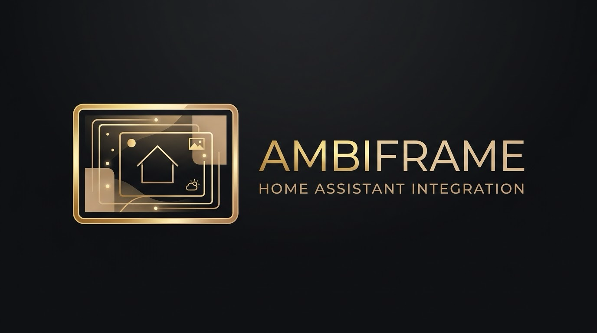</p>

<p align="center"><a href="README.md">English</a> · <b>Deutsch</b></p>

# Ambiframe

**Ruhige Ambient-Displays für Home Assistant.** Ambiframe verwandelt Tablets und Fernseher in einen Bilderrahmen mit
Verstand: Im Alltag Fotos, Uhr, Wetter und nur das, was gerade wichtig ist. Klingelt es, erscheint die Haustür.
Ist die Wäsche fertig, steht es kurz da und bleibt dann als kleine Erinnerung.

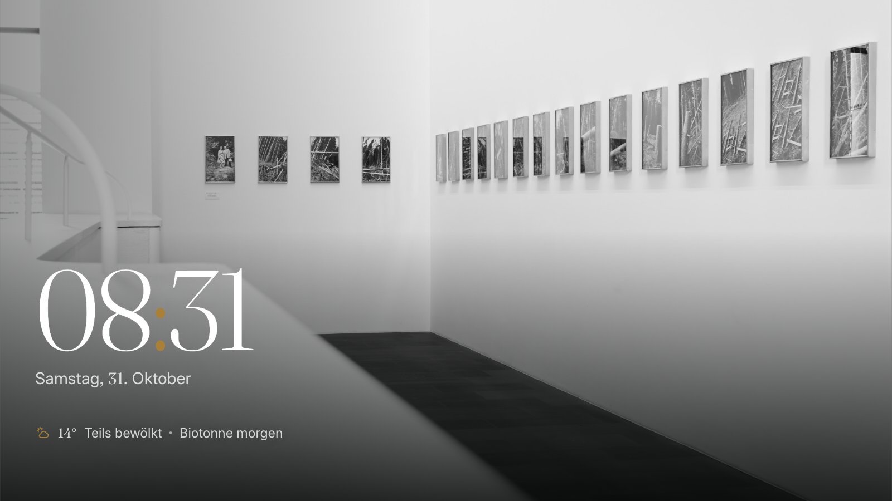

<table>
  <tr>
    <td width="33%">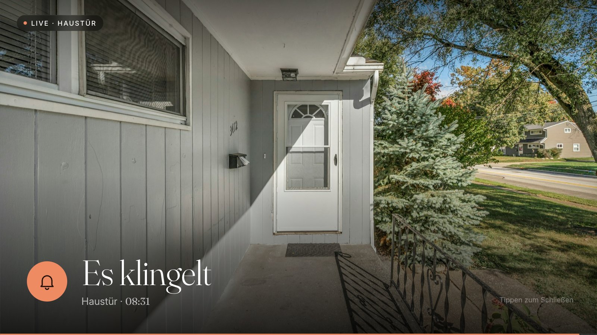</td>
    <td width="33%"></td>
    <td width="33%">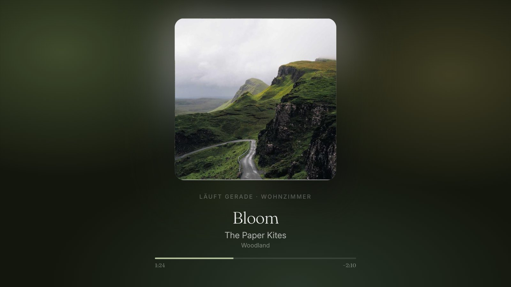</td>
  </tr>
  <tr>
    <td align="center"><sub><b>Es klingelt</b> – Livebild der Haustür</sub></td>
    <td align="center"><sub><b>Momente</b> – Konfetti zum Geburtstag</sub></td>
    <td align="center"><sub><b>Musik</b> in den Farben des Covers</sub></td>
  </tr>
  <tr>
    <td width="33%">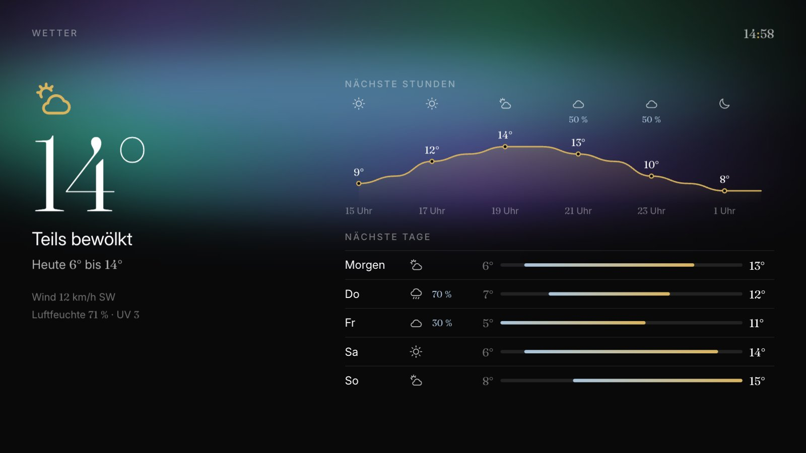</td>
    <td width="33%">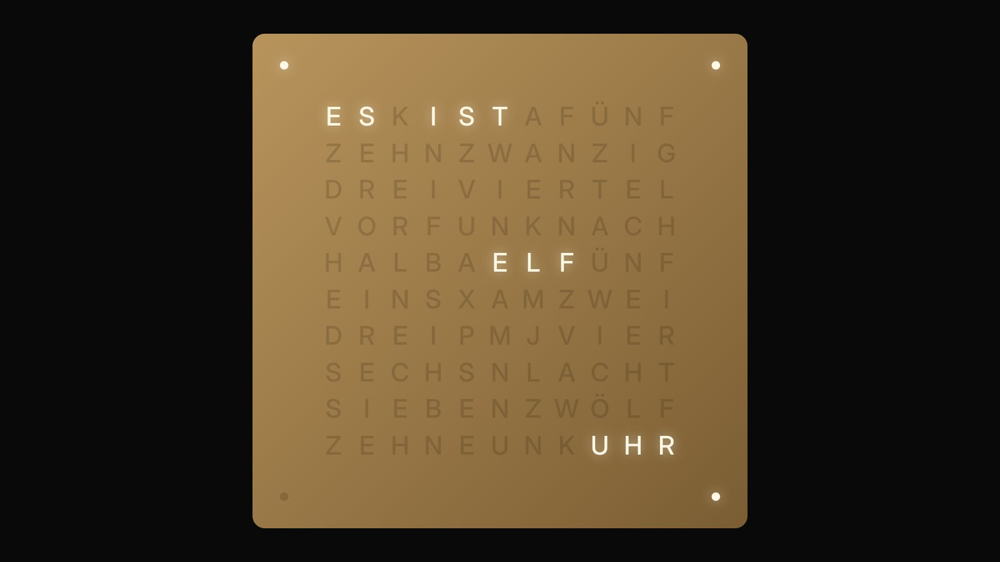</td>
    <td width="33%">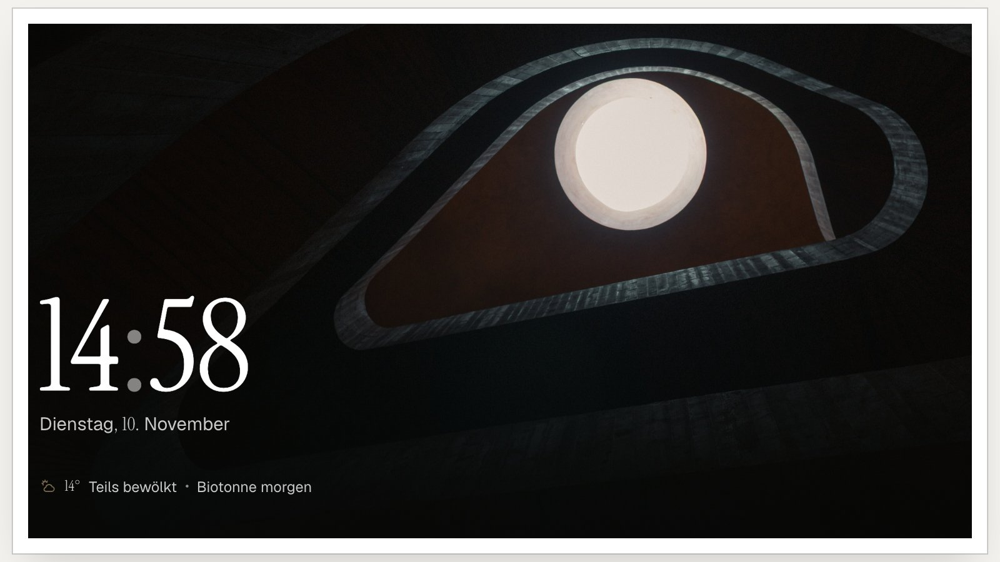</td>
  </tr>
  <tr>
    <td align="center"><sub><b>Animierte Hintergründe</b> – hier Polarlicht</sub></td>
    <td align="center"><sub><b>Wortuhr</b> in vier Sprachen</sub></td>
    <td align="center"><sub><b>36 Stile</b> – hier „Galerie“</sub></td>
  </tr>
  <tr>
    <td width="33%">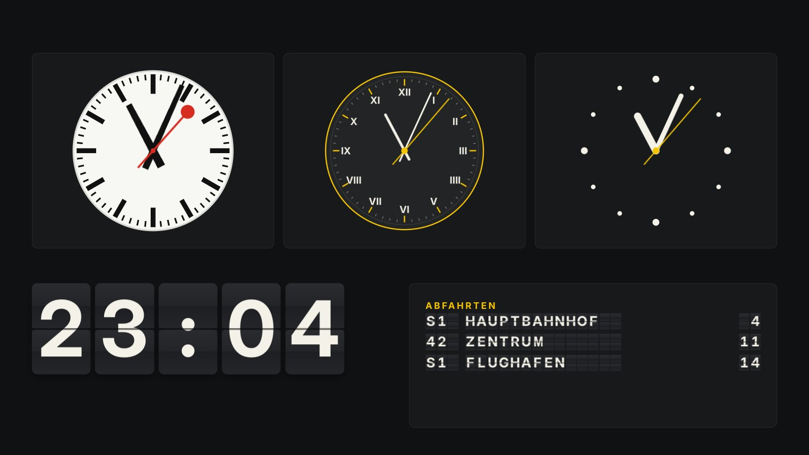</td>
    <td width="33%">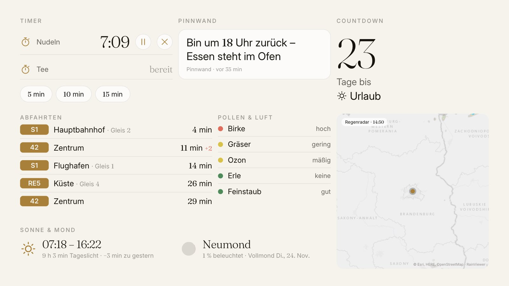</td>
    <td width="33%">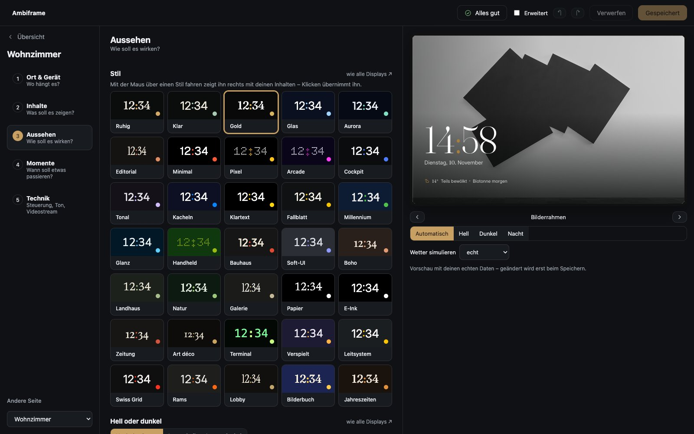</td>
  </tr>
  <tr>
    <td align="center"><sub><b>Uhren</b> – Bahnhof, Fallblatt, elegant</sub></td>
    <td align="center"><sub><b>Alltag</b> – Timer, Abfahrten, Regenradar</sub></td>
    <td align="center"><sub><b>Studio</b> – einrichten mit Live-Vorschau</sub></td>
  </tr>
</table>

<sub>Bildschirmfotos mit Beispieldaten. Fotos: <a href="https://www.instagram.com/chris.gunia">Chris Gunia</a> (die Beispielfotos ab Werk), Haustür: Unsplash. Ambiframe richtet sich nach der Sprache des HA-Benutzers (Deutsch, Englisch, Niederländisch und Französisch).</sub>

## Was Ambiframe kann

- **Seiten aus 51 Widgets** in einem 12×8-Raster mit halben Schritten: Uhr, Datum, Tagesuhr, Karte, To-do-Liste, Pendelzeit, Text, Wetter (aktuell, Karte,
  Stunden, Tage, Regen-Vorschau, Zeile), Wert, Räume, Status („Gerade“), Kalender/Müll, Infozeile, Kamera und **jede
  Lovelace-Karte** – die vollständige Liste steht unter [Widgets](#widgets).
- **Widgets für den Alltag:** Küchentimer (HA-Timer mit Schnellstart-Knöpfen), Pinnwand (Text-Helfer, z. B. vom
  Handy gesetzt), Countdown (Datum, Datum-Helfer oder Kalender), Abfahrten (ÖPNV-Sensoren, Linienfilter, Fußweg),
  animiertes Regenradar (RainViewer), Sonne & Mond (Auf- und Untergang, Tageslänge, Mondphase) sowie Pollen & Luft
  (Ampel-Stufen, Sensoren werden automatisch gefunden).
- **Karte, To-do-Liste und Pendelzeit:** Personen und Autos auf einer Karte, die sich selbst einpasst (jeden
  ausblenden, nur wer unterwegs ist, die Strecke zur Arbeit eingezeichnet); To-do- oder Einkaufsliste (`todo.*`, live,
  Antippen hakt ab, 4 s zurücknehmbar); Pendelzeit aus Waze/Google/HERE mit „losfahren bis 7:29“ und Mehrzeit im Stau.
- **Tagesuhr für Senioren:** Wochentag und Tageszeit groß in Worten („Dienstag – Nachmittag“), ganz ohne Ziffern.
- **Wiedergabeliste pro Display**. Seiten mit Bedingung (`show_if`) erscheinen nur, wenn sie relevant sind,
  z. B. Müll nur am Vorabend.
- **Ereignisse** unterbrechen die Anzeige:
  - `alarm`: Vollbild mit Livebild, etwa für die Klingel
  - `live`: Bild-im-Bild mit Abklingzeit, etwa für Bewegung
  - `info`: Hinweiskarte, danach eine Erinnerung oben rechts, etwa für die Waschmaschine
  - `page`: zeigt eine bestimmte Seite, etwa wenn ein Bewegungsmelder anschlägt – so lange er an ist,
    mindestens `duration` s, danach `hold_after` s Nachlauf, höchstens `max` s, mit `cooldown` nach dem Ende
  - `media`: Musik-Cover beim Liedwechsel (`entities`: Player, `style`: `card`/`fullscreen`,
    `interval`: zwischendurch alle n Minuten); Gruppen zeigen jedes Lied nur einmal
  - `effect`: Anlass-Animation über allem – Konfetti, Feuerwerk, Herzen, Glitzer … mit großem Titel, z. B.
    „Alles Gute!“ aus einem Geburtstagskalender
- **Ereignisse mit Ton und Regeln:** mitgelieferte Töne (Gong, Ding-Dong, Glocke, Alarm – wiederholt sich, bis
  jemand tippt) oder eigener Link, auf dem Tablet über Fully; Ruhezeiten (stumm oder gar nicht), „nur wenn jemand
  zu Hause ist“, beliebige Bedingungen und der Auslöser `to: "*"` = jede Änderung – z. B. für Tasten und
  `event.*`-Entitäten (nur frische Ereignisse, optional nur bestimmte `event_types`).
- **Eigene Töne:** Tonbibliothek im Editor – Dateien aus HA-Medien (`media-source://`), `/local/…` oder ein Link, mit ▶
  zum Probehören. Pro Ereignis: einmal, 2–10 × oder bis angetippt/geschlossen wiederholen, Abstand einstellbar.
- **Erinnerungen und Mitteilungszentrale:** Nach einem Hinweis bleibt oben rechts eine kleine Erinnerung – bis man sie
  antippt, 15 min bis 1 Tag oder gar nicht. Ab mehreren Erinnerungen stapeln sie sich wie Mitteilungen bei iOS mit Zahl;
  Antippen klappt auf oder entfernt alle. Die Mitteilungszentrale (Schnellmenü → *Mitteilungen*) zeigt, was los war,
  nach Tagen gruppiert.
- **Mini-Karte „Läuft gerade“:** dauerhaft oder je Titel eine Weile, wie lange nach einer Pause, Bedingungen und
  Ruhezeiten, Ecke, Größe, Cover, Fortschritt und Hintergrund.
- **Nachtmodus** (gedimmte Uhr, wandert gegen Einbrennen) und **Abendstimmung**.
- **Bildschirm aus, wenn alle weg sind:** Personen pro Display wählen; mit Fully geht der Bildschirm aus, Klingel und
  andere Momente wecken ihn trotzdem.
- **36 Stile, jeder hell und dunkel:** Ruhig, Klar, Gold, Glas, Aurora, Editorial, Minimal, Pixel (LED-Punktmatrix),
  Arcade (Neon), Cockpit, Tonal, Kacheln, Klartext (groß und kontrastreich), Fallblatt, Millennium, Glanz, Handheld,
  Bauhaus, Soft-UI, Boho, Landhaus, Natur, **Galerie** (Fotos im Passepartout wie im Museum), **Papier** (reines
  Schwarz-Weiß), **E-Ink** (ganz ohne Bewegung und Überblendungen, kräftige Schrift, Fotos in Graustufen – für
  E-Paper-Displays), **Zeitung**, **Art déco**, **Terminal**, **Verspielt**, **Leitsystem** (Gelb auf
  Anthrazit wie Wegweiser am Flughafen), **Swiss Grid** (strenges Raster, riesige Zahlen, Signalrot), **Rams** (warmes
  Grau, orangener Akzent, Lautsprecher-Raster), **Lobby** (Hotel-Rezeption: feine Serifen, Messinglinien),
  **Bilderbuch** (für Kinder: Hügel, Sonne oder Mond, ausgeschnittene Karten), **Weihnachten** (Tannengrün und
  Kerzengold, Lichterkette am oberen Rand, leiser Schnee) – und **Jahreszeiten**, das
  von selbst wechselt: Frühling, Sommer, Herbst, Winter, dazu Weihnachten, Silvester, Valentinstag, Ostern und
  Halloween. Kachel-Stile setzen Widgets automatisch in Karten. Hell/Dunkel automatisch nach Sonnenstand (weich
  überblendet) oder fest, pro Display änderbar.
- **Kacheln nach Wunsch:** für alle Widgets ein Kartenstil (gefüllt, Glas, nur Umriss oder ohne Fläche), Abstand und
  Ecken; pro Kachel eigene Kartenfarbe und Deckkraft, Eckenradius, Rahmen, Glas, Schatten und Überschrift an/aus.
- **Farbpaletten** über jedem Stil (Nordisch, Vampir, Mocha, Retro, Nachtstadt) oder **Tagesverlauf** – die Farben
  wandern mit der Uhrzeit. Auf Wunsch **Farben passend zum Album-Cover**: Läuft Musik, nehmen Hintergrund, Akzent und
  Karten die Cover-Farben an und blenden danach weich zurück.
- **13 Schriften** lokal mitgeliefert (u. a. Fraunces, Instrument Serif, Playfair, Inter, Geist, Outfit),
  getrennt für Uhr/Titel und Text, zusätzlich pro Widget. Zahlen (Uhrzeiten, Temperaturen, Minuten) erscheinen
  überall in der Titelschrift des Stils, Wörter in der Textschrift – so passt eine Seite zusammen.
- **Hintergrund-Animationen** – Stärke, Tempo und Farbe einstellbar, pro Seite wählbar, nachts und bei „Bewegung
  reduzieren“ aus:
  - ruhig: schwebende Partikel, fließender Verlauf, Farbwechsel, Polarlicht, Lichtschimmer, Nebel
  - Natur & Wetter: Schnee, Regentropfen am Fenster (wie kleine Linsen), Wind, ziehende Wolken, Sternenhimmel,
    Glühwürmchen, fallende Blätter, Kirschblüten, Blasen – oder **wie das Wetter**, passend zur Wetter-Entität
  - gemütlich: Kaminfeuer, Lavalampe, Wellen, Glitzer
  - kräftig: Zeichenregen, Sternenflug, Linienspiel, springendes Logo, Rohre
- **Seitenwechsel** als Überblenden, Unschärfe, Schieben, Zoom, Würfel, Umdrehen oder Blättern, Dauer frei – global,
  pro Display, pro Seite.
- **Uhren:** Wortuhr (Deutsch, Englisch, Niederländisch, Französisch; Fronten Schwarz, Weiß, Messing, Kupfer),
  analoge Uhr (Bahnhof, schlicht, elegant, Punkte), Fallblatt-Uhr und -Abfahrten, LED-Pixel-Anzeige mit
  8×8-Symbolen, Schreibmaschinen-Text.
- **Das Studio:** ein Editor für alles, immer mit Live-Vorschau – vom Display aus gedacht, mit Seiteneditor zum
  Anordnen der Widgets, Rückgängig und Hinweisen, was fehlt – siehe [Das Studio](#das-studio).
- **Bedienmodus:** Tippen holt das HA-Dashboard – aus einer Liste gewählt oder das Standard-Dashboard des jeweiligen
  Benutzers; nach einer Minute ohne Berührung kehrt Ambiframe zurück.
- **Kamera nativ** über HAs eigenen Stream (WebRTC/HLS) – alle Displays teilen sich eine Verbindung zur Kamera,
  wichtig bei Kameras, die nur wenige erlauben (z. B. Tapo). Bis das Livebild läuft, steht das letzte Standbild da
  statt einer leeren Fläche; MJPEG nur als Rückfall.
- **Fotos** aus jeder HA-Medienquelle (Ordner `ambiframe`, aber auch Immich, Synology Photos & Co.), aus einem geteilten
  **iCloud-** oder **Google-Fotos-Album** (Google inoffiziell, bis etwa 300 Fotos). Solange keine eigenen Fotos da
  sind – oder untergemischt – **Platzhalter-Bilder**: Beispielfotos ab Werk (auch offline), Wikimedia-Bild des Tages,
  gemeinfreie Gemälde, Weltall-Aufnahmen der NASA, Zufallsfotos (Lorem Picsum) oder Bing.
- **Nachrichten** aus jedem RSS-, Atom- oder RDF-Feed; Vorschläge auf Deutsch (tagesschau, n-tv, SPIEGEL, ZDFheute,
  Deutschlandfunk, ZEIT, FAZ, SZ, heise, ORF, SRF), Englisch (BBC, Guardian, Sky News, NPR, New York Times, ABC,
  CBC, Al Jazeera, DW), Niederländisch (NOS, NU.nl, VRT NWS) und Französisch (Le Monde, franceinfo, RFI, Le Figaro). Ohne eigene Wahl passend zur Sprache. Großbild mit Schlagzeile, Liste oder Laufband; der
  Server holt die Feeds (10 min zwischengespeichert) und tauscht kleine Vorschaubilder gegen große. Das Laufband ist
  pro Display schaltbar und auf dem Fernseher sowie im Videostream aus (dort würde es stehen oder ruckeln).
- **Webcams und Kameras als Hintergrund:** Seiten können eine HA-Kamera oder einen Webcam-Link (Bild, MJPEG,
  `.m3u8`, YouTube live) als Hintergrund haben; der Editor schlägt öffentliche Webcams vor. Wie stark der
  Hintergrund hinter Uhr und Text abgedunkelt wird, ist pro Seite einstellbar (normal, leicht, kräftig oder aus).
- **Infozeile mit allen Mülltonnen** im Wechsel („Biotonne und Restmüll morgen“ → „Papier am Freitag“).
- **KI-Zusammenfassung** (über `ai_task`, bevorzugt Gemini) zu festen Zeiten: Überschrift und 3–5 Punkte aus Wetter,
  Terminen, Müll, Strompreis/PV, Auto und Haus – genau den Daten, die Ambiframe ohnehin zeigt. Widget, Seite
  „Guten Morgen“, Sensor *Ambiframe Zusammenfassung* (für Ansagen), Taste und Dienst `ambiframe.generate_summary`.
- **Bedingung „Uhrzeit“** für Seiten und Widgets (`condition: time`, `after`/`before`, auch über Mitternacht).
- **Quer- und Hochformat:** Displays erkennen die Ausrichtung selbst (auch beim Drehen) oder fest per Einstellung.
  Hochkant ordnet Ambiframe jede Seite automatisch an (nebeneinander → untereinander); im Editor („Quer | Hoch“)
  lässt sich die Hochformat-Anordnung frei anpassen (`widget.portrait`). Die Bühne passt sich dem Seitenverhältnis
  an (16:9, 4:3, Handy) – ohne Balken und ohne dass Widgets gestaucht werden.
- **Weitere Bausteine:** Haustier (Zähler + Uhrzeiten + Wochenverlauf), Tagesbilanz aus der Langzeit-Statistik
  (bis 18 Uhr der Vortag, danach heute; feste Preise oder Kosten-Zähler; Zeilen nur, wenn etwas lief), WLAN-QR-Code
  für Gäste, Auftrag/3D-Druck (Fortschritt, Restzeit, Schicht, Temperaturen), Bildentitäten (z. B. Modellbild).
- **Freie Bausteine:** *Text & Vorlage* – beliebiger Text mit Jinja (`{{ states('sensor.x') }}`, live) und
  optional Markdown (Überschriften, Listen, **fett**, `[mdi:icon]`); *Verlauf* – Linie, Fläche oder Balken für eine
  oder mehrere Entitäten (bis 72 h aus dem Verlauf, länger und Balken aus der Langzeit-Statistik); *Anzeige* – Ring
  oder Halbkreis mit Farbstufen; *Bild* – Link, `/local/…`, `media-source://…`, Vorlage oder Entitätsbild.
  Vorlagen rechnet Ambiframe selbst auf dem Server: Displays ohne Admin-Benutzer dürfen nur Vorlagen auswerten,
  die in der gespeicherten Konfiguration stehen.
- **Eigenes Aussehen:** eigene Farben je Hell/Dunkel (Hintergrund, Schrift, Akzent, Karten, Gut/Warnung/Kühl)
  auf jedem Stil, Eckenradius, eigenes CSS global und pro Seite; Stile speichern, als YAML exportieren und
  importieren. Pro Widget: als Karte, Akzent- und Schriftfarbe, Größe, Deckkraft, Innenabstand (`look`).
- **Bequem bearbeiten:** Raster mit halben Zellen (Ziehen, Größe, Pfeiltasten), Mehrfachauswahl (⇧/⌘-Klick), Gruppe
  gemeinsam ziehen, Hilfslinien für bündige
  Kanten, Kopieren/Einfügen per ⌘C/⌘V (als YAML – auch zwischen Seiten, Tabs und Geräten), eigene Vorlagen für
  Widget-Gruppen und ganze Seiten, Seiten als YAML exportieren und importieren.
- **Antippen:** Jedes Widget kann beim Antippen bzw. langen Drücken etwas tun – ein/aus schalten, HA-Details
  öffnen, ein Skript/eine Aktion ausführen, eine Seite zeigen, ein Pop-up mit beliebiger Lovelace-Karte öffnen,
  die Wiedergabe anhalten oder das HA-Dashboard holen; auf Wunsch mit Rückfrage („Tor öffnen – wirklich?“).
- **Steuerbar aus Home Assistant:** Jedes Display ist ein Gerät mit den Entitäten *Seite* (Auswahl, springt
  dorthin), *Pause* (endet nach `pause_minutes`, Standard 60), *Nächste Seite*, *Neu laden*, *Verbunden* und
  *Zuletzt aktiv* – ideal für Automationen („Tesla kommt heim → Seite Energie“).
- **Läuft von selbst weiter:** Displays melden sich alle 30 s. Hängt eines, drückt Ambiframe die eingestellte
  Neustart-Taste (`watchdog.button`, z. B. Fully „Start-URL laden“). Auf Wunsch meldet Home Assistant, wenn ein
  Display seit `watchdog.notify` Minuten offline ist – die Benachrichtigung verschwindet von selbst, sobald es wieder
  da ist. Nach einem Ambiframe-Update laden sich alle Displays selbst neu – nie mitten in Klingel oder Kamera.
- **Mehrere Geräte:** Ohne `?display=` fragt ein Gerät einmal, welches Display es ist, und merkt es sich.
  Der Editor zeigt unter *Wiedergabe → Geräte*, wer gerade was anzeigt.
- **Auf den Fernseher:** Ein Display lässt sich als Videostream (bis 25 fps) an einen Apple TV (AirPlay) oder
  LG-webOS-TV schicken – per Schalter *Auf dem Fernseher* oder Aktion `ambiframe.show_on_tv` /
  `ambiframe.stop_on_tv`. Braucht die App (früher Add-on) Puppet. Schritt für Schritt:
  [`docs/airplay-apple-tv.md`](docs/airplay-apple-tv.md).
- **Sprachen:** Deutsch, Englisch, Niederländisch und Französisch – Oberfläche, Editor, Startkonfiguration und
  KI-Zusammenfassung.
- **iPad und iPhone über die HA-App:** Dashboard-Karte `custom:ambiframe-card` (`display: <id>`) im Kiosk-Modus
  zeigt Ambiframe im Vollbild, auch für Benutzer ohne Admin-Rechte.
- **Tagesinhalt und Tagesvorschau:** Wikipedia-Artikel des Tages (Deutsch, Englisch oder Schwedisch) und ein Zitat
  (Wikiquote: Zitat der Woche, oder ZenQuotes: englisches Zitat des Tages); morgens Termine, Wetter und Müll auf einen
  Blick.
- Alles wird **in Home Assistant gespeichert** (`.storage/ambiframe`) und ist damit Teil jedes Backups.

## Installation

### HACS (benutzerdefiniertes Repository)

1. HACS → ⋮ → *Benutzerdefinierte Repositories* → `https://github.com/diggi-85/ambiframe`, Typ *Integration*.
2. „Ambiframe“ installieren und Home Assistant neu starten.
3. *Einstellungen → Geräte & Dienste → Integration hinzufügen → Ambiframe*.

### Manuell

`custom_components/ambiframe` nach `/config/custom_components/` kopieren, neu starten, Integration hinzufügen.

## Einrichtung

1. In der Seitenleiste **Ambiframe** öffnen. Beim ersten Start führt ein **Einrichtungsassistent** durch Ort,
   Inhalte, Momente, Fotos und Gerät und legt aus deinen Entitäten eine Startkonfiguration an (Wetter, Räume nach
   Bereichen, Müllkalender).
2. Das Display öffnen (oder **+ Display hinzufügen**) und unter **Ort & Gerät** seine Adresse kopieren, z. B.
   `http://homeassistant.local:8123/ambiframe-display?display=ambiframe`.
3. Auf dem Tablet (empfohlen: [Fully Kiosk Browser](https://www.fully-kiosk.com)) als Start-URL eintragen und einmal anmelden.
   Am besten nimmst du dafür einen eigenen HA-Benutzer ohne Admin-Rechte.
4. Optional in Fully die *JavaScript-Schnittstelle* aktivieren. Dann weckt Ambiframe den Bildschirm bei Ereignissen.

Auf iPad oder iPhone ein Dashboard nur mit der Karte `custom:ambiframe-card` anlegen und im Kiosk-Modus der HA-App
öffnen.

## Das Studio

Alles wird im Studio eingerichtet. Gespeichert wird erst mit **Speichern** (⌘S bzw. Strg+S); **Verwerfen** holt den letzten Stand
zurück, **↶ ↷** (⌘Z, ⇧⌘Z bzw. Strg+Z, Strg+Y) machen einzelne Schritte rückgängig. Oben zeigt Ambiframe, wenn etwas fehlt (z. B. eine
Entität, die es nicht mehr gibt) – **Zeigen** springt an die Stelle.


Das Studio denkt vom Display aus. Die **Übersicht** zeigt alle Displays als Live-Vorschau samt der Geräte, die sie
gerade zeigen, dazu die Karte **Alle Displays**. Ein Display beantwortet in fünf Schritten dieselben Fragen:

| Schritt | Frage | Was du dort einstellst |
|---|---|---|
| **Ort & Gerät** | Wo hängt es? | Ort (setzt passende Vorgaben), Gerät (Fully, Browser oder HA-App) mit Adresse zum Kopieren |
| **Inhalte** | Was soll es zeigen? | Seiten der Wiedergabeliste, Reihenfolge, Dauer, „Wann?“ (z. B. nur morgens) und die Nacht |
| **Aussehen** | Wie soll es wirken? | Stil, Hell/Dunkel, Farben, Kacheln, Hintergrund-Animation |
| **Momente** | Wann soll etwas passieren? | Klingel, Bewegung, Wäsche fertig, Musik, Geburtstag … mit **▶ Testen**, eigene Töne |
| **Technik** | Steuerung, Ton, Videostream | Bedienmodus, Neustart-Taste und Offline-Meldung, Töne, Videostream zum Fernseher, Fotos |

**Alle Displays** ist die gemeinsame Seite: Aussehen für alle, Momente, die **Seiten-Bibliothek** sowie Fotos & KI.
Was ein Display nicht selbst festlegt, kommt von dort. Kleine Hinweise zeigen die Herkunft – *wie alle Displays ↗*
oder *eigener Wert ↺* (ein Klick setzt ihn zurück).

Rechts läuft immer die **Vorschau** mit deinen echten Daten: Seiten durchblättern, Hell/Dunkel/Nacht umschalten, Wetter
simulieren (Sonne, Regen, Schnee, Wind, klare Nacht) und Momente testen, ohne etwas zu speichern. Fährt die Maus über
einen Stil, zeigt die Vorschau ihn sofort.

**Erweitert** (oben, wird pro Gerät gemerkt) blendet alles Weitere ein: zusätzliche Felder, eigene Bedingungen in der
Wiedergabeliste, Schriften, Kontrast und Textgröße, eigene Farben je Hell/Dunkel, eigenes CSS, eigene Stile (speichern,
exportieren, importieren) und unter *Alle Displays → Fotos & KI* die ganze Konfiguration als **YAML**.

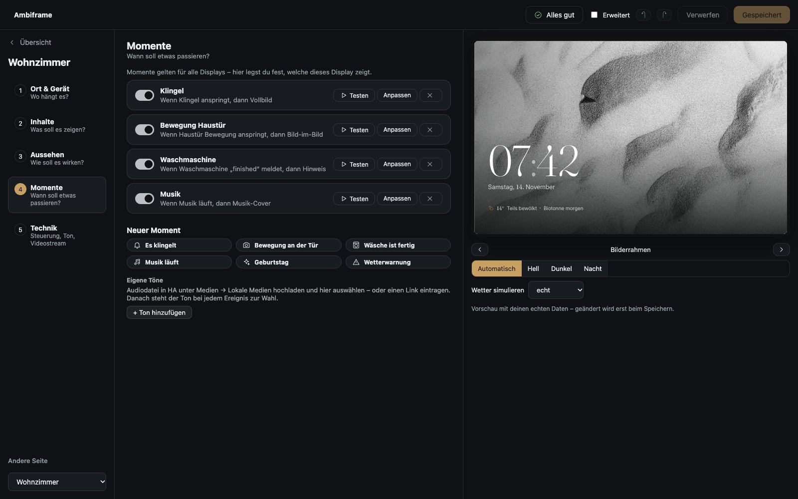

Momente gelten für alle Displays; pro Display schaltest du nur ein oder aus, welche es zeigt. **Neuer Moment** bietet
fertige Vorlagen an und schlägt den Auslöser aus deinen Entitäten vor.

Beim ersten Start führt ein **Einrichtungsassistent** durch Ort, Inhalte, Momente, Fotos und Gerät.

### Seiten gestalten

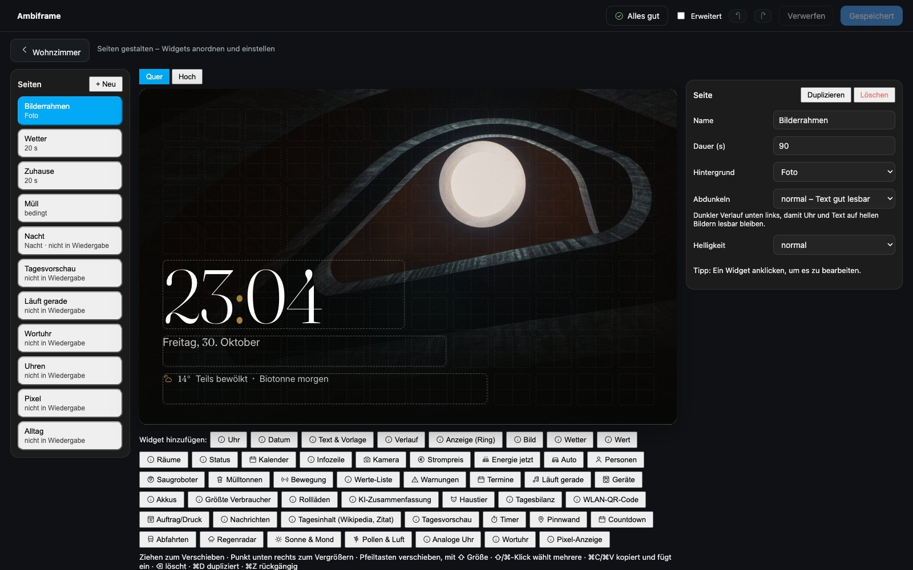

**Gestalten** bei einer Seite (unter *Inhalte* oder in der Seiten-Bibliothek) öffnet den Seiteneditor im Studio:
links alle Seiten, in der Mitte die Seite als Live-Bild, rechts die Einstellungen des gewählten Widgets oder der Seite.
**Zurück** führt dorthin, wo du herkamst.

- Widgets aus der Leiste unten hinzufügen, ziehen, an der Ecke unten rechts vergrößern; Raster mit halben Zellen und
  Hilfslinien für bündige Kanten.
- Mehrfachauswahl mit ⇧/⌘-Klick (Windows: Umschalt/Strg), Pfeiltasten verschieben (mit ⇧ in der Größe), ⌘C/⌘V (Strg+C/V) kopiert als YAML – auch
  zwischen Seiten und Geräten, ⌘D dupliziert, ⌫ löscht.
- **Quer | Hoch** wechselt zur Hochformat-Anordnung, die sich getrennt anpassen lässt.
- Pro Seite: Dauer, Hintergrund (Foto, Kamera, Webcam, Farbe), Abdunkeln, Helligkeit, Übergang, Animation, Bedingung.
- Pro Widget (mit *Erweitert*): Bedingung, Kachel (Karte, Farbe, Radius, Rahmen, Glas, Schatten, Überschrift), Farben,
  Größe und was beim Antippen passiert; eigene Vorlagen für Widget-Gruppen und ganze Seiten, Seiten als YAML.

## Konfiguration

Im Studio unter **Alle Displays → Fotos & KI → Für Fortgeschrittene: YAML** (mit **Erweitert**) oder per Aktion
`ambiframe.import_config`. Eine passende
Startkonfiguration legt Ambiframe beim ersten Start selbst an; sie lässt sich dort als YAML ansehen und anpassen.
Ein vollständiges Beispiel steht in [`examples/beispiel.yaml`](examples/beispiel.yaml).

```yaml
displays:
  - id: wohnzimmer
    name: Wohnzimmer
    playlist: [{ page: foto }, { page: wetter, duration: 20 }]
    watchdog: { notify: 30 }    # HA-Benachrichtigung nach 30 min offline
    night: { entity: input_boolean.nachtruhe, page: nacht }
    control: { enabled: true, dashboard: /lovelace/0, idle: 60 }

pages:
  - id: foto
    name: Bilderrahmen
    duration: 90
    background: { type: photo, shade: light }   # shade: none | light | strong
    widgets:
      - { id: uhr, type: clock, x: 0, y: 4, w: 6, h: 2, options: { valign: end } }
      - { id: datum, type: date, x: 0, y: 6, w: 7, h: 1 }

events:
  - id: klingel
    entity: binary_sensor.haustuer_klingel
    to: "on"
    kind: alarm                 # alarm | live | info | page | media | effect
    camera: camera.haustuer
    title: Es klingelt
    where: Haustür
    hold_after: 30              # nach dem Klingeln noch 30 s stehen lassen

  - id: esstisch
    kind: page                  # Seite zeigen statt Overlay
    entity: binary_sensor.esstisch_praesenz
    entities: [binary_sensor.kueche_bewegung]   # weitere Auslöser – einer genügt
    to: "on"
    page: heute
    duration: 60
    hold_after: 30
    cooldown: 300

  - id: musik
    kind: media
    entities: [media_player.kueche, media_player.wohnzimmer]
    style: card                 # card | fullscreen
```

### Widgets

| Typ | Wichtige Optionen |
|---|---|
| `clock` | `size` (auto/small), `seconds`, `font`, `color`, `style: flap` (Fallblatt) |
| `analog` | `face` (schlicht/bahnhof/elegant/punkte), `seconds`, `numbers` |
| `wordclock` | `face` (black/white/brass/copper/accent), `color`, `font`, `glow`, `dots`, `prefix`, `language` |
| `pixel` | `items: [{type: time/date, entity, attribute, text, icon, unit, decimals, color}]`, `interval`, `frame` |
| `date` | `format` (long/short), `size`, `color`, `style: card` |
| `dayclock` | Tagesuhr für Senioren: Wochentag und Tageszeit in Worten („Dienstag – Nachmittag“), darunter das Datum; `date: false`, `time: true`, `color` |
| `text` | `text` (darf Jinja enthalten), `markdown`, `style` (label/title/body/big), `size`, `color`, `icon` |
| `chart` | `entities: [{entity, name, color}]`, `kind` (line/area/bar), `hours`, `period` (hour/day), `value`, `min`, `max`, `unit`, `decimals`, `label`, `style: card` |
| `gauge` | `entity`, `attribute`, `kind` (ring/half), `min`, `max`, `unit`, `decimals`, `color`, `severity: [{from, color}]`, `name`, `icon` |
| `image` | `url` (Link, `/local/…`, `media-source://…`, Vorlage) oder `entity`, `fit` (cover/contain), `refresh`, `caption`, `radius` |
| `weather` | `entity`, `variant` (now/card/hourly/daily/rain/line), `hours`, `days`, `name`, `rain_sensor`, `threshold` |
| `value` | `entity`, `attribute`, `name`, `unit`, `decimals`, `style: card`, `label`, `icon`, `sub`, `secondary`, `cold` |
| `rooms` | `rooms: [{name, temperature, humidity, climate, windows}]`, `cold`, `warm`, `columns` |
| `status` | `windows` (auto/Liste), `appliances`, `lights: auto`, `waste`, `waste_days`, `extra`, `max` |
| `calendar` | `entity`, `variant` (card/line), `waste`, `days`, `label` |
| `infoline` | `items: [{type: weather/calendar/entity/text, …}]` |
| `camera` | `entity` oder `url` (Webcam), `mode` (live/snapshot), `refresh`, `title`, `text`, `radius` |
| `agenda` | `calendars`, `days`, `max`, `location` |
| `today` | `calendars`, `weather` – Termine, Wetter und Müll des Tages |
| `waste` | `bins: [{name, entity, color, out}]`, `max`, `highlight` (Tage) |
| `activity` | `variant: list` (Standard: eine Zeile), `entities`, `exclude`, `max`, `within` (Minuten) |
| `warnings` | `entities`, `calm_text` |
| `list` | `rows: [{name, entity, attribute, icon, format, unit, decimals}]` |
| `persons` | `persons: [{entity, name, location}]` |
| `media` | `entities`, `variant: full` (Standard: kompakt), `show_paused` |
| `appliances` | `items: [{name, running, icon, power, progress, end, cost}]`, `empty_text` |
| `price` | `entity`, `home` (Tibber), `window` (günstigste Stunden), `tomorrow`, `note` |
| `power` | `production: [{name, entity}]`, `consumption`, `consumption_first`, `forecast`, `forecast_remaining`, `extra`, `extra_name` |
| `consumers` | `count`, `devices`, `exclude` |
| `balance` | `switch_hour`, `groups` (YAML) |
| `batteries` | `part`, `devices`, `threshold`, `max`, `exclude` |
| `car` | `name`, `battery`, `range`, `location`, `charging`, `plugged`, `charger_power`, `time_full`, `lock`, `limit`, `inside_temp` |
| `vacuum` | `vacuums: [{entity, name, battery, room, map}]` |
| `covers` | `covers: [{entity, name, invert}]`, `only_open` |
| `pet` | `name`, `visits`, `unit`, `days`, `icon` |
| `job` | `title`, `progress`, `remaining`, `end`, `layer`, `layers`, `status`, `temps` (z. B. 3D-Drucker) |
| `qr` | `ssid`, `password`, `encryption`, `hidden`, `show_password`, `hint` oder `image` |
| `news` | `variant` (`list`/`ticker`, Standard: Großbild), `feeds`, `interval`, `max`, `speed` |
| `daily` | `kind: quote` (Standard: Wikipedia-Artikel), `language`, `source`, `image` |
| `summary` | `style: card` (Standard: ohne Rahmen), `size` |
| `timer` | `entities` (timer.*, leer = alle), `presets` („5, 10, 15“ Minuten), `target`, `show_idle` |
| `board` | `entities` (input_text/text, leer = Namen mit „pinnwand“, „nachricht“, „notiz“), `expire_hours`, `size`, `empty_text` |
| `countdown` | `items: [{name, date \| entity, icon}]` (input_datetime, Zeitstempel-Sensor, Kalender), `max`, `show_past` |
| `departures` | `entities` (ÖPNV-Sensoren, leer = automatisch), `lines`, `walk` (Minuten), `max`, `show_platform`, `attribute` |
| `map` | Personen und Fahrzeuge auf einer Karte, die sich selbst einpasst (wer am selben Ort ist, erscheint als Avatar-Stapel): `entities` (person.*, device_tracker.*; leer = alle mit Standort), `exclude` (nie zeigen), `away_only` (nur wer unterwegs ist), `tags` (full/name/none), `routes` (Reisezeit-Sensoren – ihre Strecke wird eingezeichnet; Start- und Zieladresse gehen dafür einmal an Nominatim und OSRM von OpenStreetMap, ein unbekannter Start wird `zone.home`), `zone`, `max_zoom`, `map` (auto/light/dark/osm) |
| `todo` | To-do- oder Einkaufsliste (todo.*), live; Antippen hakt ab, 4 s zurücknehmbar: `entity`, `check: false`, `max`, `show_completed`, `size` |
| `commute` | Pendelzeit aus Waze-/Google-/HERE-Sensoren: `routes: [{entity, name, arrive („08:00“ → losfahren bis), usual (Minuten)}]` |
| `radar` | `zoom` (4–7), `map` (auto/light/dark/osm), `map_url`, `frames` (6 = letzte Stunde), `speed`, `latitude`/`longitude` |
| `sky` | `show` (sun/moon, leer = beides), `latitude`/`longitude` (Standard: Zuhause) |
| `air` | `entities: [{entity, name, kind, scale}]` (pollen, aqi, pm25, pm10, ozone, no2; leer = automatisch), `only_elevated`, `max` |
| `card` | `card:` beliebige Lovelace-Karten-Konfiguration |

Für alle Widgets gelten `align`/`valign` (start/center/end), `show_if` (Bedingungen) sowie `tap_action` und
`hold_action`:

```yaml
tap_action: { action: toggle, entity: light.kueche }
tap_action: { action: perform, perform: script.turn_on, entity: script.gute_nacht, confirm: true }
tap_action: { action: page, page: energie }
tap_action: { action: popup, title: Licht, card: { type: entities, entities: [light.kueche] }, timeout: 30 }
hold_action: { action: pause }          # außerdem: more_info (entity), dashboard
look: { card: true, accent: "#4fa3e0", ink: "#fff", size: 120, opacity: 80, padding: 12 }
```

### Bedingungen

```yaml
show_if:
  - { condition: state, entity: binary_sensor.fenster, state: "on" }
  - { condition: numeric, entity: sensor.co2, above: 1000 }
  - { condition: within_days, entity: calendar.muell, days: 1 }
  - { condition: time, after: "05:00", before: "11:00" }
  - { condition: changed, entity: binary_sensor.tuer, minutes: 10 }      # kürzlich geändert (optional state)
  - { condition: template, value_template: "{{ is_state('person.alex', 'home') }}" }
  - { condition: display, displays: [wohnzimmer] }                     # nur auf diesen Displays
  - { condition: orientation, orientation: portrait }                    # nur hochkant
  - condition: or                                                        # auch and / not, beliebig tief
    conditions:
      - { condition: state, entity: person.kim, state: home }
      - { condition: state, entity: person.alex, state: home }
```

Bedingungen gelten für Seiten, Widgets und **einzelne Einträge der Wiedergabeliste** (`playlist[].show_if`) –
so zeigt ein Display morgens andere Seiten als abends (Editor: *Wiedergabe → Wann?*).

## Entwicklung

```bash
cd frontend && npm install && npm run build      # Bundle nach custom_components/ambiframe/frontend/
```

Tests: `cd frontend && npm test` (Frontend) und `python -m pytest` (Integration, Abhängigkeiten in
`requirements_test.txt`). `cd frontend && npm run visual` vergleicht alle Stile als Bild mit Referenzbildern (Chrome
nötig; Referenzbilder erzeugt `npm run visual:update` beim ersten Lauf). Welche Anforderung durch welchen Test
abgesichert ist, steht in [`docs/testmatrix.md`](docs/testmatrix.md).

## Lizenz

MIT. Die mitgelieferten Schriften stehen unter der SIL Open Font License 1.1. Die Beispielfotos ab Werk sind von
[Chris Gunia](https://www.instagram.com/chris.gunia) – alle Rechte vorbehalten, nur zur Nutzung in Ambiframe.
