<p align="center"><picture>
  <source media="(prefers-color-scheme: dark)" srcset="https://raw.githubusercontent.com/diggi-85/ambiframe/main/docs/brand/logo-claim-de-light.svg">
  
</picture></p>

<h3 align="center">Dein Tablet wird zum schönsten Bildschirm im Haus.</h3>

<p align="center">
  Ein Bilderrahmen, der mitdenkt: Fotos, Uhr und Wetter – und genau dann, wenn es zählt,<br>
  die Haustür, die fertige Wäsche oder das Lied, das gerade läuft.<br>
  <b>Für Home Assistant. Kostenlos. Ohne Cloud-Konto.</b>
</p>

<p align="center">
  <a href="https://my.home-assistant.io/redirect/hacs_repository/?owner=diggi-85&repository=ambiframe&category=integration"></a>
</p>

<p align="center">
  
  
  
  
</p>

<p align="center"><a href="README.md">English</a> · <b>Deutsch</b></p>

<p align="center">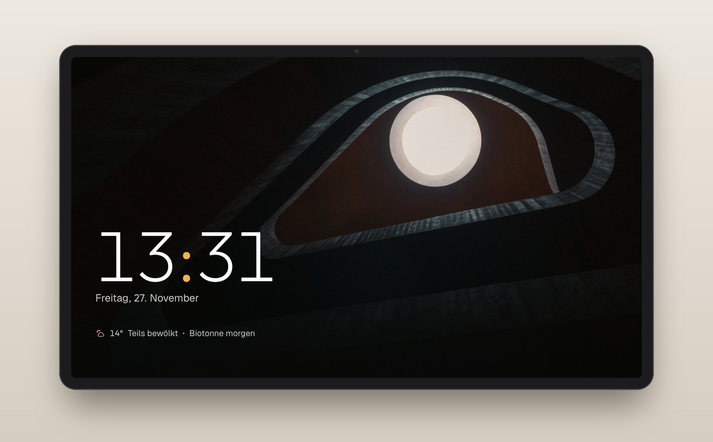</p>

---

## Warum Ambiframe?

Ein Dashboard an der Wand ist praktisch – und meistens unruhig: Knöpfe, Zahlen und Kacheln, die niemand ansieht.
Ambiframe dreht das um. **Im Alltag ist es ein ruhiger, schöner Bildschirm.** Erst wenn etwas passiert, meldet er sich –
und tritt danach wieder zurück.

<table>
  <tr>
    <td width="25%" valign="top"><b>🖼️ Schön statt laut</b><br><sub>30 Stile, jeder hell und dunkel, mit geprüftem Kontrast. Vom Galerie-Passepartout bis zur Neon-Arcade – jede Seite wie aus einem Guss.</sub></td>
    <td width="25%" valign="top"><b>🔔 Meldet sich, wenn es zählt</b><br><sub>Klingel mit Livebild, Wäsche fertig, Musik, Geburtstag mit Konfetti – „Momente“ unterbrechen die Anzeige und verschwinden wieder.</sub></td>
    <td width="25%" valign="top"><b>🎛️ Einrichten ohne YAML</b><br><sub>Das Studio mit Live-Vorschau: Display wählen, Inhalte, Aussehen, Momente – fertig. Ein Assistent baut beim ersten Start alles aus deinen Geräten.</sub></td>
    <td width="25%" valign="top"><b>🏠 Ganz deins</b><br><sub>Läuft komplett in deinem Home Assistant und steckt in jedem Backup. Kein Konto, kein Abo, keine fremde Cloud.</sub></td>
  </tr>
</table>

## So sieht es aus

<table>
  <tr>
    <td width="50%">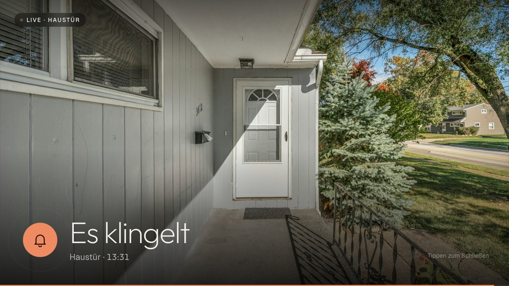</td>
    <td width="50%">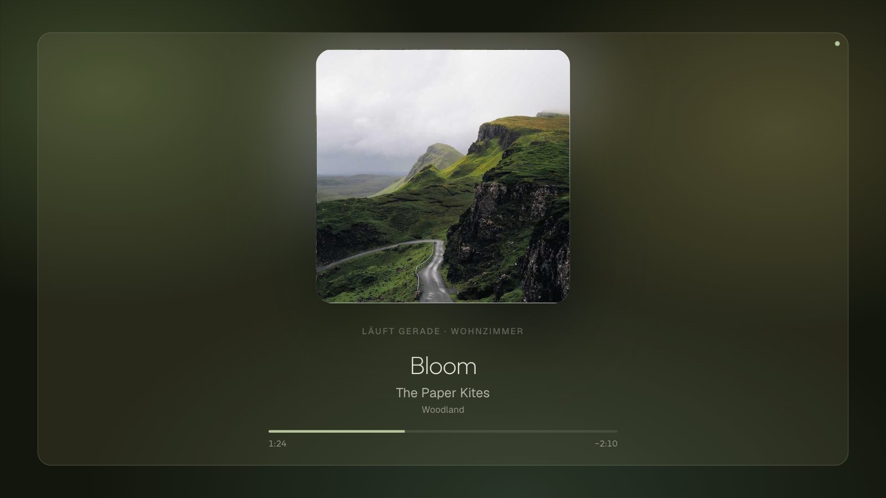</td>
  </tr>
  <tr>
    <td align="center"><b>Es klingelt.</b> Die Haustür erscheint sofort im Vollbild – auf allen Displays, über eine einzige Kamera-Verbindung.</td>
    <td align="center"><b>Läuft gerade.</b> Beim Liedwechsel das Cover – auf Wunsch nimmt der ganze Bildschirm die Farben des Albums an.</td>
  </tr>
  <tr>
    <td>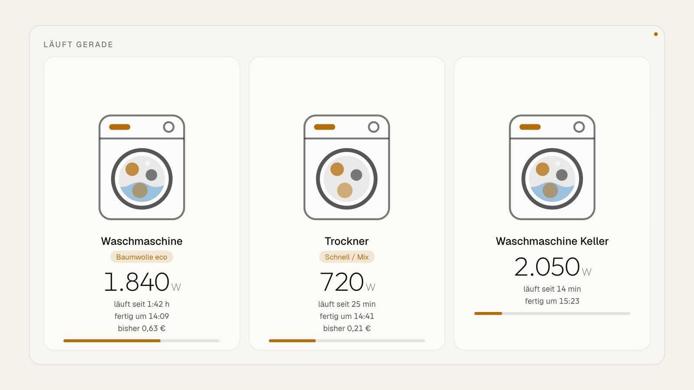</td>
    <td>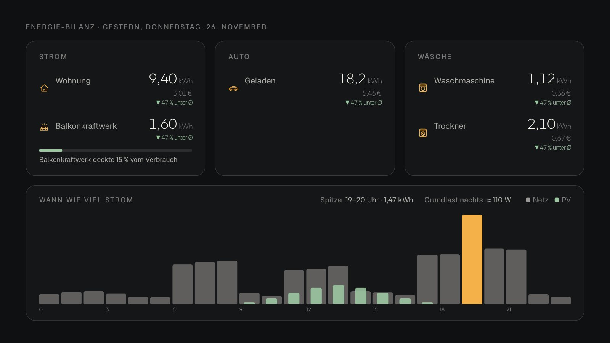</td>
  </tr>
  <tr>
    <td align="center"><b>Wäsche im Blick.</b> Programm, Leistung, „fertig um“ und was der Gang bisher kostet – animiert, solange die Maschine läuft.</td>
    <td align="center"><b>Wohin der Strom geht.</b> Tagesbilanz mit Kosten, Solaranteil, Vergleich mit dem Durchschnitt und Stundenverlauf.</td>
  </tr>
  <tr>
    <td>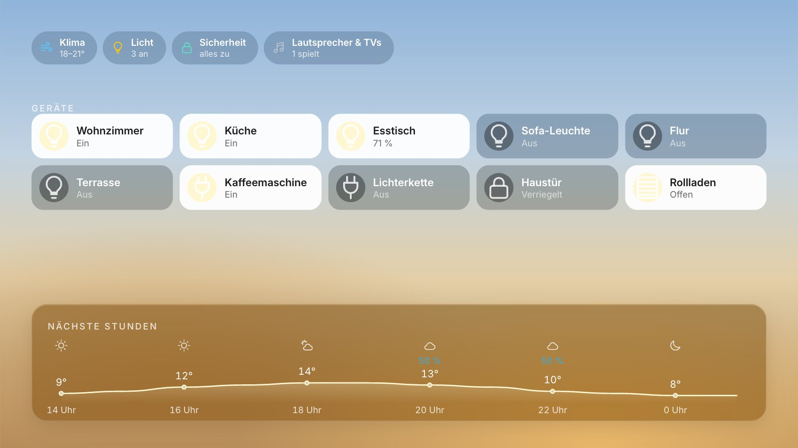</td>
    <td>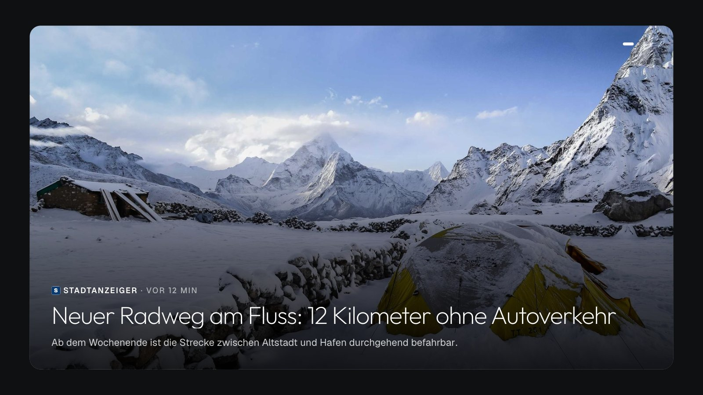</td>
  </tr>
  <tr>
    <td align="center"><b>Wie eine Smart-Home-App.</b> Antippen schaltet Licht und Steckdosen, oben die Lage auf einen Blick.</td>
    <td align="center"><b>Nachrichten.</b> Aus jedem RSS-Feed, mit großem Bild und dem Logo der Quelle – oder als Laufband über allen Seiten.</td>
  </tr>
  <tr>
    <td>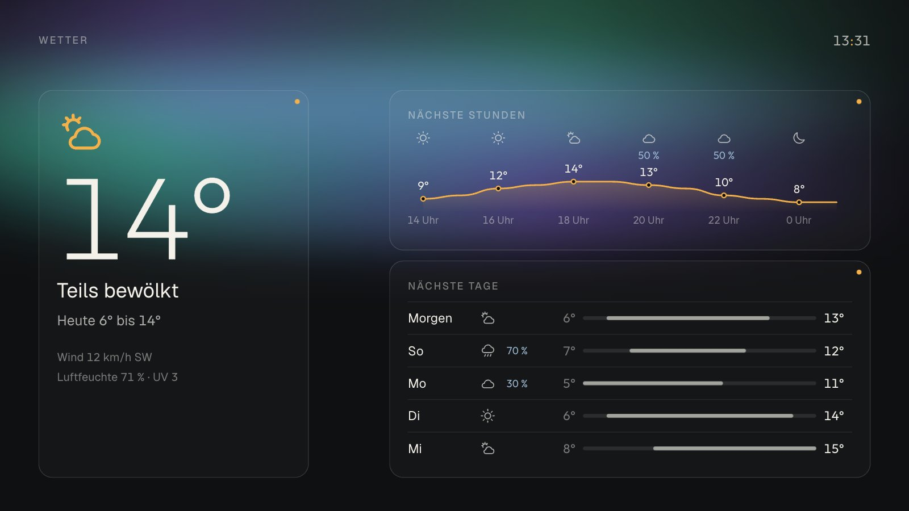</td>
    <td></td>
  </tr>
  <tr>
    <td align="center"><b>28 Hintergrund-Animationen.</b> Polarlicht, Schnee, Kaminfeuer, Regentropfen am Fenster – oder einfach „wie das Wetter“.</td>
    <td align="center"><b>Besondere Momente.</b> Konfetti, Feuerwerk oder Herzen – etwa automatisch aus dem Geburtstagskalender.</td>
  </tr>
  <tr>
    <td>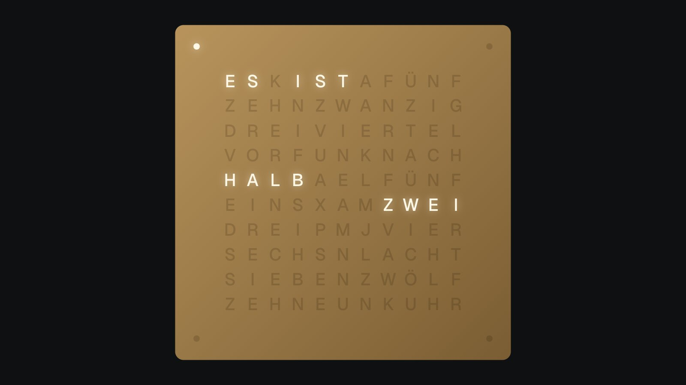</td>
    <td>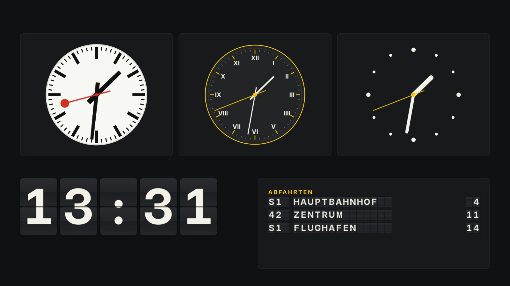</td>
  </tr>
  <tr>
    <td align="center"><b>Wortuhr</b> in vier Sprachen – Schwarz, Weiß, Messing oder Kupfer.</td>
    <td align="center"><b>Uhren zum Verlieben.</b> Bahnhof, elegant, Punkte – und Fallblatt wie am Gleis.</td>
  </tr>
  <tr>
    <td>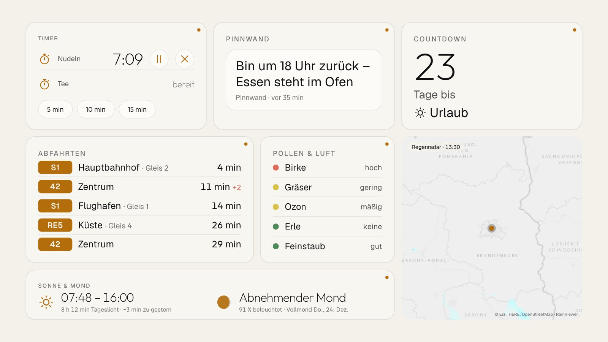</td>
    <td></td>
  </tr>
  <tr>
    <td align="center"><b>Für den Alltag.</b> Küchentimer, Pinnwand, Countdown, Abfahrten, Pollen und Regenradar.</td>
    <td align="center"><b>Und meistens: einfach schön.</b> Deine Fotos aus HA, iCloud oder Google – Uhr und Wetter darüber.</td>
  </tr>
</table>

### 30 Stile – ein Klick

<p align="center">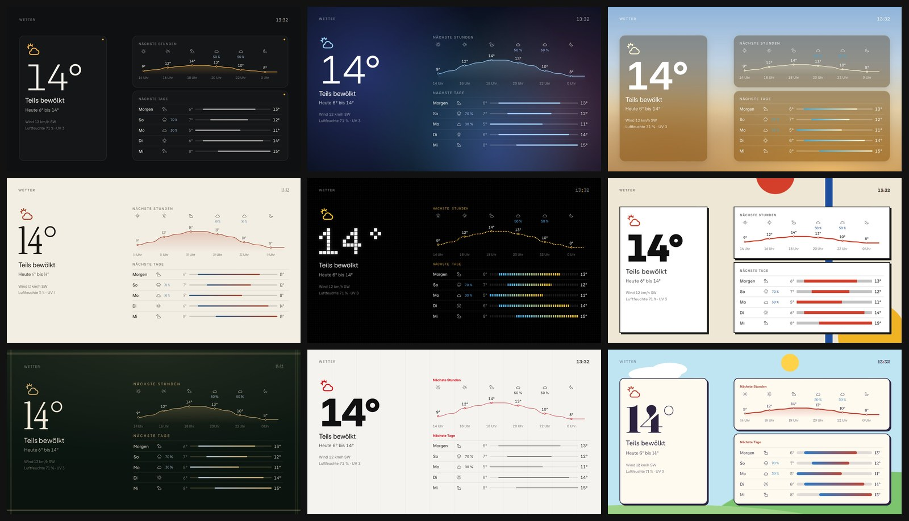</p>

<p align="center"><sub>Dieselbe Seite in Ambiframe, Glas, Daheim, Editorial, Pixel, Bauhaus, Lobby, Swiss Grid und Bilderbuch.<br>Im Studio zeigt die Vorschau jeden Stil, sobald die Maus darüber fährt.</sub></p>

<sub>Bildschirmfotos mit Beispieldaten. Fotos: <a href="https://www.instagram.com/chris.gunia">Chris Gunia</a> (die Beispielfotos ab Werk); Haustür, Nachrichtenbilder und Cover: Unsplash. Die Nachrichtenquellen in den Bildern sind erfunden.</sub>

## In fünf Minuten an der Wand

1. **Installieren** – mit dem Knopf oben über HACS (oder [manuell](#manuell)), dann Home Assistant neu starten.
2. **Integration hinzufügen** – *Einstellungen → Geräte & Dienste → Integration hinzufügen → Ambiframe*.
3. **Assistent folgen** – In der Seitenleiste **Ambiframe** öffnen. Der Assistent fragt nach Ort, Inhalten, Momenten und
   Fotos und baut aus deinen Geräten eine fertige Startkonfiguration: Wetter, Räume nach Bereichen, Müllkalender.
4. **Tablet verbinden** – Die Adresse des Displays aus dem Studio kopieren und auf dem Tablet öffnen
   (am besten in [Fully Kiosk Browser](https://www.fully-kiosk.com)). Fertig.

Auf iPad und iPhone geht es auch ohne Fully: die Karte `custom:ambiframe-card` in ein Dashboard legen und die HA-App
im Kiosk-Modus öffnen.

## Das Studio – alles mit Live-Vorschau

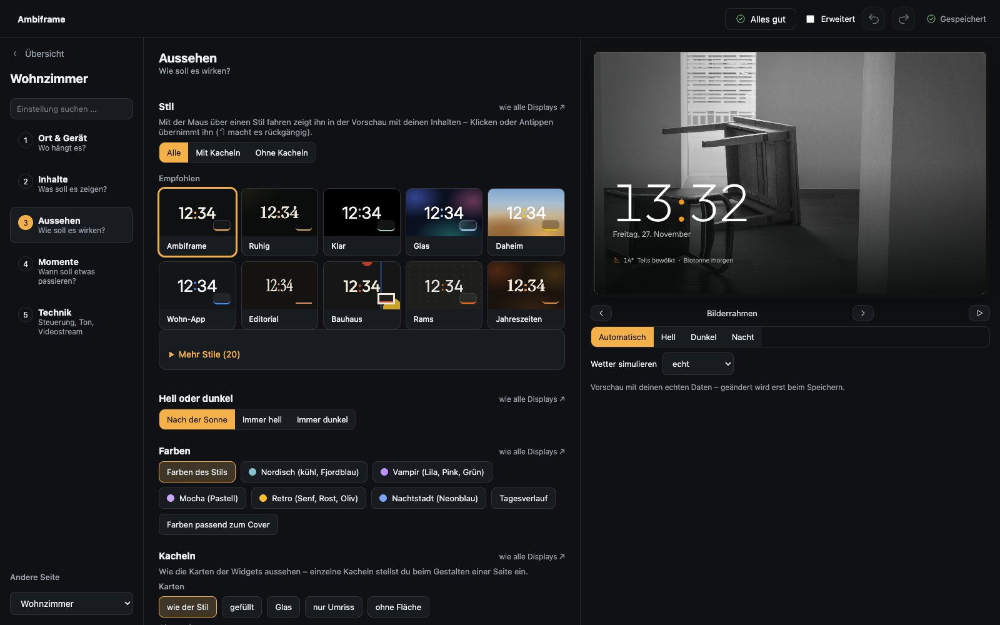

Kein YAML, kein Raten. Das Studio denkt vom Display aus und stellt fünf einfache Fragen:

| Schritt | Frage | Was du einstellst |
|---|---|---|
| **Ort & Gerät** | Wo hängt es? | Ort (setzt passende Vorgaben), Gerät (Fully, Browser oder HA-App) mit Adresse zum Kopieren |
| **Inhalte** | Was soll es zeigen? | Seiten der Wiedergabeliste, Reihenfolge per Ziehen, Dauer, „Wann?“ (z. B. nur morgens) und die Nacht |
| **Aussehen** | Wie soll es wirken? | Stil, Hell/Dunkel, Farben, Kacheln, Hintergrund-Animation, Bewegung |
| **Momente** | Wann soll etwas passieren? | Klingel, Bewegung, Wäsche fertig, Musik, Geburtstag … mit **▶ Testen** und eigenen Tönen |
| **Technik** | Steuerung, Ton, Fernseher | Bedienmodus, Neustart-Taste, Offline-Meldung, Töne, Videostream zum Fernseher |

Rechts läuft immer die **Vorschau mit deinen echten Daten**: Seiten durchblättern, Hell/Dunkel/Nacht umschalten, Wetter
simulieren (Sonne, Regen, Schnee, Wind) und Momente testen – ohne etwas zu speichern. **↶ ↷** nimmt jeden Schritt
zurück, und oben zeigt Ambiframe, wenn etwas fehlt – **Zeigen** springt direkt an die Stelle. **Alle Displays** hält,
was für alle gilt; jedes Display kann davon abweichen.

<table>
  <tr>
    <td width="50%">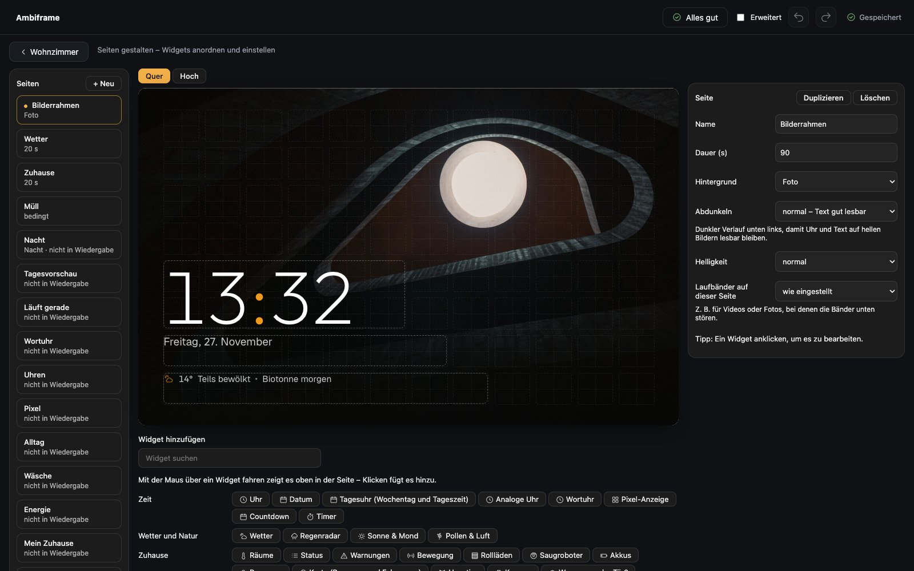</td>
    <td width="50%">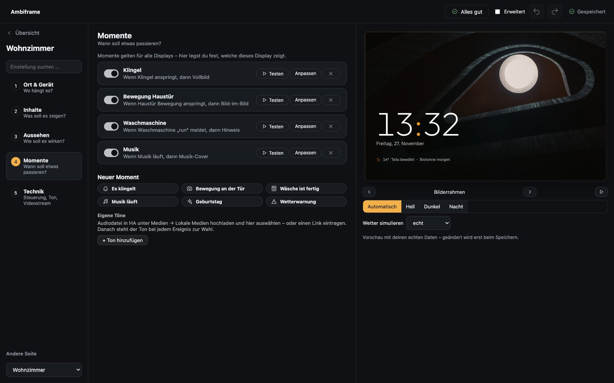</td>
  </tr>
  <tr>
    <td align="center"><b>Seiteneditor.</b> Widgets ziehen, vergrößern, ausrichten – mit Hilfslinien, Mehrfachauswahl, ⌘C/⌘V und eigenen Vorlagen.</td>
    <td align="center"><b>Momente.</b> Fertige Vorlagen, Auslöser aus deinen Entitäten vorgeschlagen, mit einem Klick testen.</td>
  </tr>
</table>

## Was Ambiframe alles kann

<details open>
<summary><b>🔔 Momente – der Bildschirm meldet sich, wenn es zählt</b></summary>

- **Klingel und Kamera:** Vollbild mit Livebild (`alarm`) oder Bild-im-Bild (`live`) – zwei Kameras auch nebeneinander,
  Antippen vergrößert, Ecke, Größe und Form einstellbar. Alle Displays teilen sich **eine** Verbindung zur Kamera
  (wichtig bei Kameras, die nur wenige erlauben, z. B. Tapo); bis das Livebild läuft, steht das letzte Standbild da.
- **Hinweise:** erst eine Karte, dann eine kleine Erinnerung oben rechts – etwa „Wäsche fertig“. Mehrere stapeln sich
  wie Mitteilungen auf dem iPhone; die **Mitteilungszentrale** zeigt, was los war, nach Tagen gruppiert.
- **Musik:** Cover beim Liedwechsel als Karte, Vollbild, Leiste, Pille oder Mini-Karte – auch Mini *und* kurz Vollbild.
  Auf Wunsch nimmt der ganze Bildschirm die Farben des Albums an.
- **Seite zeigen:** Ein Bewegungsmelder schlägt an, die passende Seite erscheint – solange er an ist, mit Nachlauf,
  Höchstdauer und Abklingzeit.
- **Anlässe:** Konfetti, Feuerwerk, Herzen, Glitzer … mit großem Titel – z. B. „Alles Gute!“ aus dem Geburtstagskalender.
- **Mit Ton und Regeln:** Gong, Ding-Dong, Glocke, Alarm oder eigene Töne aus HA-Medien; Ruhezeiten (stumm oder gar
  nicht), „nur wenn jemand zu Hause ist“, beliebige Bedingungen, Tasten und `event.*`-Entitäten.
- **Wer war an der Tür?** Die letzten Klingel- und Kamera-Momente mit Standbild.

</details>

<details>
<summary><b>🧩 55 Widgets – von der Uhr bis zur Lovelace-Karte</b></summary>

- **Zeit:** Uhr, Datum, Wortuhr (4 Sprachen, 4 Fronten), analoge Uhren (Bahnhof, schlicht, elegant, Punkte), Fallblatt,
  LED-Pixel-Anzeige, **Tagesuhr für Senioren** („Dienstag – Nachmittag“, ganz ohne Ziffern).
- **Wetter:** aktuell, Karte, Stunden, Tage, Regen-Vorschau, animiertes **Regenradar**, Sonne & Mond, Pollen & Luft,
  DWD- und NINA-**Warnungen** mit dem Logo der Quelle.
- **Zuhause:** Räume mit Lüftungs-Tipps, „Gerade“-Status, **Smart-Home-Kacheln** mit Übersichts-Pillen, Rollläden,
  Akkus, Saugroboter mit Karte, Haustier, Auftrag/3D-Druck, WLAN-QR-Code für Gäste.
- **Energie:** Strompreis (Tibber, günstigste Stunden), PV und Verbrauch, größte Verbraucher, **Tages- und
  Wochenbilanz** mit Stundenverlauf, Kosten und Solaranteil, **Haushaltsgeräte** mit Programm, Restzeit und Kosten,
  Auto (Akku, Reichweite, Laden, Schloss).
- **Unterwegs:** Karte mit Personen und Autos, Pendelzeit („losfahren bis 7:29“), Abfahrten, Kalender und Agenda,
  Müll mit **deutschen Tonnen in ihren echten Farben** – oder dem Gelben Sack.
- **Alltag:** Küchentimer, Pinnwand (vom Handy gesetzt), Countdown, To-do- und Einkaufsliste (Antippen hakt ab).
- **Lesen:** Nachrichten aus jedem RSS-/Atom-Feed (mit Logo, und die Quelle wird schon beim Eintragen geprüft),
  *tagesschau in 100 Sekunden* als Video, Wikipedia-Artikel und Zitat des Tages, **KI-Zusammenfassung** am Morgen
  (über `ai_task`).
- **Freie Bausteine:** Text mit Jinja und Markdown, Verlauf (Linie, Fläche, Balken), Anzeige (Ring/Halbkreis), Bild,
  Kamera und Webcam – und **jede Lovelace-Karte**.
- **Antippen:** Jedes Widget kann schalten, eine Aktion ausführen, eine Seite oder ein Pop-up mit Lovelace-Karte
  zeigen – auf Wunsch mit Rückfrage („Tor öffnen – wirklich?“).

Die vollständige Liste mit allen Optionen steht unter [Widgets](#widgets).

</details>

<details>
<summary><b>🎨 Aussehen – 30 Stile, Animationen, Bewegung</b></summary>

- **30 Stile, jeder hell und dunkel:** **Ambiframe** (der Stil der Marke und Standard: Tinte und Papier, feine runde Rahmen, ein Lichtpunkt in Bernstein), Ruhig, **Klar** (wie StandBy), Glas, Aurora, Editorial, Pixel, Arcade, Cockpit,
  Daheim, Wohn-App, Axel, Klartext, Fallblatt, Bauhaus, Soft-UI, Boho, Landhaus, **Galerie**, **Papier**, **E-Ink**
  (für E-Paper-Displays), Art déco, Terminal, Verspielt, **Leitsystem**, **Swiss Grid**, **Rams**, **Lobby**,
  **Bilderbuch** (für Kinder) – und **Jahreszeiten**, das von selbst wechselt: Frühling bis Winter, Weihnachten,
  Silvester, Valentinstag, Ostern, Halloween. Jeder Stil hält einen geprüften Mindestkontrast ein.
- **Hell und dunkel nach Sonnenstand** – weich überblendet – oder fest, pro Display.
- **Farbpaletten** (Nordisch, Vampir, Mocha, Retro, Nachtstadt) oder **Tagesverlauf**: die Farben wandern mit der Uhrzeit.
- **28 Hintergrund-Animationen:** Partikel, Polarlicht, Nebel, Schnee, Regentropfen am Fenster, Wind, Wolken,
  Sternenhimmel, Glühwürmchen, Blätter, Kirschblüten, Kaminfeuer, Lavalampe, Wellen … oder **wie das Wetter**.
- **Bewegung mit Gefühl:** Balken wachsen, Kurven zeichnen sich ein, Zahlen zählen hoch – ruhig, federnd oder
  einblendend. Widgets, die auf der nächsten Seite gleich sind, bleiben beim Wechsel einfach stehen.
- **10 Seitenwechsel:** Überblenden, Unschärfe, Schieben, Zoom, Würfel, Umdrehen, Blättern, Vorhang, Kreis,
  Aufsteigen – oder jedes Mal ein anderer.
- **Laufbänder im Stil:** schwebend, als Leiste oder nur als Linie – passend zum gewählten Stil.
- **13 Schriften** lokal mitgeliefert, Kartenstile (gefüllt, Glas, Umriss), eigene Farben je Hell/Dunkel, eigenes CSS,
  Stile speichern, teilen und importieren.

</details>

<details>
<summary><b>📰 Laufbänder – nur da, wenn etwas zutrifft</b></summary>

- **Laufband für Zuhause:** erscheint nur, solange etwas zutrifft – Fenster seit 20 Minuten offen, Waschmaschine
  fertig, Akku unter 15 %, eine Unwetterwarnung. Gruppen fassen zusammen („3 Fenster offen“), ein Tipp auf eine Zeile
  zeigt die Einzelheiten.
- **Nachrichten-Laufband** über allen Seiten – auf Wunsch gemischt mit dem Band für Zuhause und dem laufenden Lied.
- Neue Meldungen laufen hinten an – nichts, was man gerade liest, springt.

</details>

<details>
<summary><b>📷 Fotos – deine, aus jeder Quelle</b></summary>

- Jede **HA-Medienquelle** (Ordner, Immich, Synology Photos …), ein geteiltes **iCloud-** oder **Google-Fotos-Album**.
- Hochkant-Fotos auf Querformat-Displays als **Paar nebeneinander** statt abgeschnitten.
- Solange keine eigenen da sind: Beispielfotos ab Werk (auch offline), Wikimedia-Bild des Tages, gemeinfreie Gemälde,
  NASA-Aufnahmen.
- Webcams und HA-Kameras als Seitenhintergrund.

</details>

<details>
<summary><b>📺 Geräte und Betrieb – läuft einfach</b></summary>

- **Jedes Tablet:** Fully Kiosk (weckt den Bildschirm bei Momenten und schaltet ihn aus, wenn alle weg sind), jeder
  Browser, iPad und iPhone über die HA-App.
- **Auf den Fernseher:** als Videostream an Apple TV (AirPlay) oder LG webOS – siehe
  [`docs/airplay-apple-tv.md`](docs/airplay-apple-tv.md).
- **Quer und hoch:** Seiten ordnen sich hochkant von selbst um; jedes Seitenverhältnis ohne Balken.
- **Nachtmodus** mit gedimmter, wandernder Uhr. **Bedienmodus:** Tippen holt das HA-Dashboard, nach einer Minute geht es zurück.
- **Steuerbar aus Home Assistant:** Jedes Display ist ein Gerät mit *Seite*, *Pause*, *Nächste Seite*, *Neu laden* und
  *Verbunden* – ideal für Automationen („Auto kommt heim → Seite Energie“).
- **Läuft von selbst weiter:** Hängt ein Display, startet Ambiframe es neu; nach einem Update laden sich alle Displays
  selbst – nie mitten in einer Klingel.
- **Lesbar von weit weg:** Fernseiten mit einer einzigen, riesigen Information.
- **Vier Sprachen:** Deutsch, Englisch, Niederländisch, Französisch – Oberfläche, Studio und KI-Zusammenfassung.
- Alles wird **in Home Assistant gespeichert** und ist Teil jedes Backups.

</details>

## Installation

### HACS (empfohlen)

<a href="https://my.home-assistant.io/redirect/hacs_repository/?owner=diggi-85&repository=ambiframe&category=integration"></a>

Oder von Hand:

1. HACS → ⋮ → *Benutzerdefinierte Repositories* → `https://github.com/diggi-85/ambiframe`, Typ *Integration*.
2. „Ambiframe“ installieren und Home Assistant neu starten.
3. *Einstellungen → Geräte & Dienste → Integration hinzufügen → Ambiframe*.

### Manuell

`custom_components/ambiframe` nach `/config/custom_components/` kopieren, neu starten, Integration hinzufügen.

### Das Tablet einrichten

1. In der Seitenleiste **Ambiframe** öffnen, das Display wählen (oder **+ Display hinzufügen**) und unter
   **Ort & Gerät** seine Adresse kopieren, z. B. `http://homeassistant.local:8123/ambiframe-display?display=ambiframe`.
2. Auf dem Tablet (empfohlen: [Fully Kiosk Browser](https://www.fully-kiosk.com)) als Start-URL eintragen und einmal
   anmelden – am besten mit einem eigenen HA-Benutzer ohne Admin-Rechte.
3. Optional in Fully die *JavaScript-Schnittstelle* aktivieren: Dann weckt Ambiframe den Bildschirm bei Momenten.

## Häufige Fragen

<details>
<summary><b>Welches Tablet brauche ich?</b></summary>

Jedes mit einem aktuellen Browser. Günstige Android-Tablets mit Fully Kiosk sind ideal, weil Ambiframe dann den
Bildschirm wecken und ausschalten kann. iPads laufen über die HA-App. Auf schwachen Geräten wählt Ambiframe von selbst
sparsamere Übergänge, und für E-Paper-Displays gibt es den Stil **E-Ink** ganz ohne Bewegung.

</details>

<details>
<summary><b>Ersetzt Ambiframe mein Dashboard?</b></summary>

Es ergänzt es. Ambiframe ist für den Bildschirm, den man im Vorbeigehen sieht. Tippt man darauf, holt der
**Bedienmodus** dein gewohntes HA-Dashboard; nach einer Minute ohne Berührung kehrt Ambiframe zurück. Jede
Lovelace-Karte lässt sich außerdem direkt als Widget einbauen.

</details>

<details>
<summary><b>Brauche ich ein Konto oder eine Cloud?</b></summary>

Nein. Ambiframe läuft vollständig in deinem Home Assistant und speichert alles dort. Ins Internet geht es nur für
Inhalte, die du selbst wählst – etwa Nachrichten-Feeds, das Regenradar, Platzhalter-Fotos oder ein geteiltes Album.

</details>

<details>
<summary><b>Muss ich YAML können?</b></summary>

Nein. Alles geht im Studio mit Live-Vorschau. Wer möchte, findet unter *Erweitert* die ganze Konfiguration als YAML –
siehe [Für Fortgeschrittene](#für-fortgeschrittene).

</details>

<details>
<summary><b>Was kostet es?</b></summary>

Nichts. Ambiframe ist Open Source unter der MIT-Lizenz.

</details>

---

## Für Fortgeschrittene

### Konfiguration

Im Studio unter **Alle Displays → Fotos & KI → Für Fortgeschrittene: YAML** (mit **Erweitert**) oder per Aktion
`ambiframe.import_config`. Eine passende
Startkonfiguration legt Ambiframe beim ersten Start selbst an; sie lässt sich dort als YAML ansehen und anpassen.
Ein vollständiges Beispiel steht in [`examples/beispiel.yaml`](examples/beispiel.yaml).

```yaml
displays:
  - id: wohnzimmer
    name: Wohnzimmer
    playlist: [{ page: foto }, { page: wetter, duration: 20 }]
    watchdog: { notify: 30 }    # HA-Benachrichtigung nach 30 min offline
    night: { entity: input_boolean.nachtruhe, page: nacht }
    control: { enabled: true, dashboard: /lovelace/0, idle: 60 }

pages:
  - id: foto
    name: Bilderrahmen
    duration: 90
    background: { type: photo, shade: light }   # shade: none | light | strong
    widgets:
      - { id: uhr, type: clock, x: 0, y: 4, w: 6, h: 2, options: { valign: end } }
      - { id: datum, type: date, x: 0, y: 6, w: 7, h: 1 }

events:
  - id: klingel
    entity: binary_sensor.haustuer_klingel
    to: "on"
    kind: alarm                 # alarm | live | info | page | media | effect
    camera: camera.haustuer
    title: Es klingelt
    where: Haustür
    hold_after: 30              # nach dem Klingeln noch 30 s stehen lassen

  - id: esstisch
    kind: page                  # Seite zeigen statt Overlay
    entity: binary_sensor.esstisch_praesenz
    entities: [binary_sensor.kueche_bewegung]   # weitere Auslöser – einer genügt
    to: "on"
    page: heute
    duration: 60
    hold_after: 30
    cooldown: 300

  - id: musik
    kind: media
    entities: [media_player.kueche, media_player.wohnzimmer]
    style: card                 # card | fullscreen
```

### Widgets

| Typ | Wichtige Optionen |
|---|---|
| `clock` | `size` (auto/small), `seconds`, `font`, `color`, `style: flap` (Fallblatt) |
| `analog` | `face` (schlicht/bahnhof/elegant/punkte), `seconds`, `numbers` |
| `wordclock` | `face` (black/white/brass/copper/accent), `color`, `font`, `glow`, `dots`, `prefix`, `language` |
| `pixel` | `items: [{type: time/date, entity, attribute, text, icon, unit, decimals, color}]`, `interval`, `frame` |
| `date` | `format` (long/short), `size`, `color`, `style: card` |
| `dayclock` | Tagesuhr für Senioren: Wochentag und Tageszeit in Worten („Dienstag – Nachmittag“), darunter das Datum; `date: false`, `time: true`, `color` |
| `text` | `text` (darf Jinja enthalten), `markdown`, `style` (label/title/body/big, `huge` füllt das Feld), `size`, `color`, `icon` |
| `chart` | `entities: [{entity, name, color}]`, `kind` (line/area/bar), `hours`, `period` (hour/day), `value`, `min`, `max`, `unit`, `decimals`, `label`, `style: card` |
| `gauge` | `entity`, `attribute`, `kind` (ring/half), `min`, `max`, `unit`, `decimals`, `color`, `severity: [{from, color}]`, `name`, `icon` |
| `image` | `url` (Link, `/local/…`, `media-source://…`, Vorlage) oder `entity`, `fit` (cover/contain), `refresh`, `caption`, `radius` |
| `weather` | `entity`, `variant` (now/card/hourly/daily/rain/line), `hours`, `days`, `name`, `rain_sensor`, `threshold` |
| `value` | `entity`, `attribute`, `name`, `unit`, `decimals`, `style` (`card` oder `huge` – füllt das Feld), `label`, `icon`, `sub`, `secondary`, `cold` |
| `rooms` | `rooms: [{name, temperature, humidity, climate, windows}]`, `cold`, `warm`, `columns` |
| `status` | `windows` (auto/Liste), `appliances`, `lights: auto`, `waste`, `waste_days`, `extra`, `max` |
| `calendar` | `entity`, `variant` (card/line), `waste`, `days`, `label` |
| `infoline` | `items: [{type: weather/calendar/entity/text, …}]` |
| `camera` | `entity` oder `url` (Webcam), `mode` (live/snapshot), `refresh`, `title`, `text`, `radius` |
| `agenda` | `calendars`, `days`, `max`, `location` |
| `today` | `calendars`, `weather` – Termine, Wetter und Müll des Tages |
| `waste` | `bins: [{name, entity, color, out}]`, `max`, `highlight` (Tage) |
| `activity` | `variant: list` (Standard: eine Zeile), `entities`, `exclude`, `max`, `within` (Minuten) |
| `warnings` | Offene Warnungen mit Überschrift, Stufe, Zeitraum, Absender und Beschreibung – NINA (alte und neue Integration) und DWD, dieselbe Meldung nur einmal: `entities` (leer = automatisch gefunden), `variant: full` (je Warnung eine Karte mit Beschreibung, Empfehlung, Messwerten, Zeitraum, Absender, betroffenen Gebieten und Warnfarbe), `calm_text` |
| `list` | `rows: [{name, entity, attribute, icon, format, unit, decimals}]` |
| `persons` | `persons: [{entity, name, location}]` |
| `media` | `entities`, `variant: full` (Standard: kompakt), `show_paused` |
| `appliances` | `items: [{name, running, icon, power, progress, end, cost, program}]`, `variant: cards` (animierte Karte je laufendem Gerät), `empty_text` |
| `price` | `entity`, `home` (Tibber), `window` (günstigste Stunden), `tomorrow`, `note` |
| `power` | `production: [{name, entity}]`, `consumption`, `consumption_first`, `forecast`, `forecast_remaining`, `extra`, `extra_name` |
| `consumers` | `count`, `devices`, `exclude` |
| `balance` | `switch_hour`, `period: week` (Wochenrückblick), `profile: {entity, solar}` (Stundenverlauf), `compare` (Vergleich mit dem Durchschnitt), `groups` (YAML) |
| `batteries` | `part`, `devices`, `threshold`, `max`, `exclude` |
| `car` | `name`, `battery`, `range`, `location`, `charging`, `plugged`, `charger_power`, `time_full`, `lock`, `limit`, `inside_temp` |
| `vacuum` | `vacuums: [{entity, name, battery, room, map}]` |
| `covers` | `covers: [{entity, name, invert}]`, `only_open` |
| `pet` | `name`, `visits`, `unit`, `days`, `icon` |
| `job` | `title`, `progress`, `remaining`, `end`, `layer`, `layers`, `status`, `temps` (z. B. 3D-Drucker) |
| `qr` | `ssid`, `password`, `encryption`, `hidden`, `show_password`, `hint` oder `image` |
| `news` | `variant` (`list`/`ticker`, Standard: Großbild), `feeds`, `interval`, `max`, `speed` |
| `newsvideo` | Die neueste *tagesschau in 100 Sekunden*, stumm und in Dauerschleife, daneben oder darunter die aktuellen Schlagzeilen (auf E-Ink nur das Vorschaubild). Nur für den privaten, nicht-kommerziellen Gebrauch, wie es die tagesschau erlaubt (höchstens 60 Abrufe pro Stunde – die Video-Prüfung braucht 4, alle 15 Minuten): `headlines` (false = nur Video), `layout` (`below`, oder `fullscreen` – nur Video, bis an die Ränder), `until_end` (nächste Seite erst nach dem Video, höchstens 5 Minuten), `feeds`, `max`, `label` |
| `daily` | `kind: quote` (Standard: Wikipedia-Artikel), `language`, `source`, `image` |
| `summary` | `style: card` (Standard: ohne Rahmen), `size` |
| `timer` | `entities` (timer.*, leer = alle), `presets` („5, 10, 15“ Minuten), `target`, `show_idle` |
| `board` | `entities` (input_text/text, leer = Namen mit „pinnwand“, „nachricht“, „notiz“), `expire_hours`, `size`, `empty_text` |
| `countdown` | `items: [{name, date \| entity, icon}]` (input_datetime, Zeitstempel-Sensor, Kalender), `max`, `show_past` |
| `departures` | `entities` (ÖPNV-Sensoren, leer = automatisch), `lines`, `walk` (Minuten), `max`, `show_platform`, `attribute` |
| `doorlog` | Wer war an der Tür: die letzten Klingel- und Kamera-Momente mit Standbild (HA merkt sich 20, unter `/config/ambiframe/snapshots`): `max` |
| `map` | Personen und Fahrzeuge auf einer Karte, die sich selbst einpasst (wer am selben Ort ist, erscheint als Avatar-Stapel): `entities` (person.*, device_tracker.*; leer = alle mit Standort), `exclude` (nie zeigen), `away_only` (nur wer unterwegs ist), `tags` (full/name/none), `routes` (Reisezeit-Sensoren – ihre Strecke wird eingezeichnet; Start- und Zieladresse gehen dafür einmal an Nominatim und OSRM von OpenStreetMap, ein unbekannter Start wird `zone.home`), `zone`, `max_zoom`, `map` (auto/light/dark/osm) |
| `todo` | To-do- oder Einkaufsliste (todo.*), live; Antippen hakt ab, 4 s zurücknehmbar: `entity`, `check: false`, `max`, `show_completed`, `size` |
| `commute` | Pendelzeit aus Waze-/Google-/HERE-Sensoren: `routes: [{entity, name, arrive („08:00“ → losfahren bis), usual (Minuten)}]` |
| `radar` | `zoom` (4–7), `map` (auto/light/dark/osm), `map_url`, `frames` (6 = letzte Stunde), `speed`, `latitude`/`longitude` |
| `sky` | `show` (sun/moon, leer = beides), `latitude`/`longitude` (Standard: Zuhause) |
| `air` | `entities: [{entity, name, kind, scale}]` (pollen, aqi, pm25, pm10, ozone, no2; leer = automatisch), `only_elevated`, `max` |
| `hometiles` | Smart-Home-Kacheln: `entities` (Antippen schaltet Licht, Schalter, Ventilator), `label` |
| `pills` | Übersicht als Pillen: Klima, Licht, Sicherheit, Lautsprecher – automatisch aus deinen Entitäten |
| `card` | `card:` beliebige Lovelace-Karten-Konfiguration |

Für alle Widgets gelten `align`/`valign` (start/center/end), `show_if` (Bedingungen) sowie `tap_action` und
`hold_action`:

```yaml
tap_action: { action: toggle, entity: light.kueche }
tap_action: { action: perform, perform: script.turn_on, entity: script.gute_nacht, confirm: true }
tap_action: { action: page, page: energie }
tap_action: { action: popup, title: Licht, card: { type: entities, entities: [light.kueche] }, timeout: 30 }
hold_action: { action: pause }          # außerdem: more_info (entity), dashboard
look: { card: true, accent: "#4fa3e0", ink: "#fff", size: 120, opacity: 80, padding: 12 }
```

### Bedingungen

```yaml
show_if:
  - { condition: state, entity: binary_sensor.fenster, state: "on" }
  - { condition: numeric, entity: sensor.co2, above: 1000 }
  - { condition: within_days, entity: calendar.muell, days: 1 }
  - { condition: time, after: "05:00", before: "11:00" }
  - { condition: changed, entity: binary_sensor.tuer, minutes: 10 }      # kürzlich geändert (optional state)
  - { condition: template, value_template: "{{ is_state('person.alex', 'home') }}" }
  - { condition: display, displays: [wohnzimmer] }                     # nur auf diesen Displays
  - { condition: orientation, orientation: portrait }                    # nur hochkant
  - condition: or                                                        # auch and / not, beliebig tief
    conditions:
      - { condition: state, entity: person.kim, state: home }
      - { condition: state, entity: person.alex, state: home }
```

Bedingungen gelten für Seiten, Widgets und **einzelne Einträge der Wiedergabeliste** (`playlist[].show_if`) –
so zeigt ein Display morgens andere Seiten als abends (Editor: *Wiedergabe → Wann?*).

## Entwicklung

```bash
cd frontend && npm install && npm run build      # Bundle nach custom_components/ambiframe/frontend/
```

Tests: `cd frontend && npm test` (Frontend) und `python -m pytest` (Integration, Abhängigkeiten in
`requirements_test.txt`). `cd frontend && npm run visual` vergleicht alle Stile als Bild mit Referenzbildern (Chrome
nötig; Referenzbilder erzeugt `npm run visual:update` beim ersten Lauf). Welche Anforderung durch welchen Test
abgesichert ist, steht in [`docs/testmatrix.md`](docs/testmatrix.md).

## Lizenz

MIT. Die mitgelieferten Schriften stehen unter der SIL Open Font License 1.1. Die Beispielfotos ab Werk sind von
[Chris Gunia](https://www.instagram.com/chris.gunia) – alle Rechte vorbehalten, nur zur Nutzung in Ambiframe.
