<p align="center"><picture>
  <source media="(prefers-color-scheme: dark)" srcset="https://raw.githubusercontent.com/diggi-85/ambiframe/main/docs/brand/logo-claim-en-light.svg">
  
</picture></p>

<h3 align="center">Turn your tablet into the most beautiful screen in your home.</h3>

<p align="center">
  A photo frame that thinks along: photos, the time and the weather – and right when it matters,<br>
  the front door, the finished laundry or the song that's playing.<br>
  <b>For Home Assistant. Free. No cloud account.</b>
</p>

<p align="center">
  <a href="https://my.home-assistant.io/redirect/hacs_repository/?owner=diggi-85&repository=ambiframe&category=integration"></a>
</p>

<p align="center">
  
  
  
  
</p>

<p align="center"><b>English</b> · <a href="README.de.md">Deutsch</a></p>

<p align="center">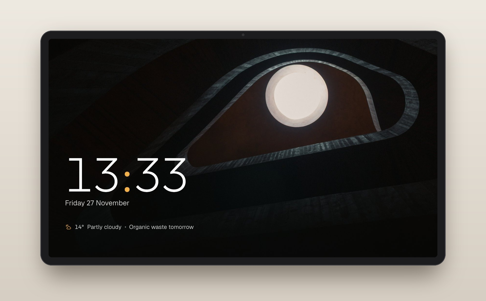</p>

---

## Why Ambiframe?

A dashboard on the wall is handy – and usually busy: buttons, numbers and tiles nobody looks at. Ambiframe flips that
around. **Day to day it's a calm, beautiful screen.** Only when something happens does it speak up – and then it steps
back again.

<table>
  <tr>
    <td width="25%" valign="top"><b>🖼️ Beautiful, not busy</b><br><sub>30 styles, each light and dark, with checked contrast. From a gallery mount to a neon arcade – every page looks of a piece.</sub></td>
    <td width="25%" valign="top"><b>🔔 Speaks up when it matters</b><br><sub>Doorbell with live video, laundry done, music, a birthday with confetti – “moments” interrupt the display and then fade away.</sub></td>
    <td width="25%" valign="top"><b>🎛️ Set up without YAML</b><br><sub>The Studio with a live preview: pick a display, contents, look, moments – done. A wizard builds everything from your devices on first start.</sub></td>
    <td width="25%" valign="top"><b>🏠 All yours</b><br><sub>Runs entirely inside your Home Assistant and is part of every backup. No account, no subscription, no third-party cloud.</sub></td>
  </tr>
</table>

## See it in action

<table>
  <tr>
    <td width="50%">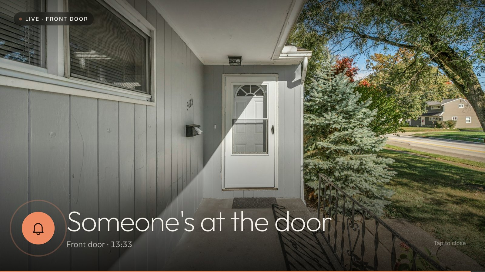</td>
    <td width="50%">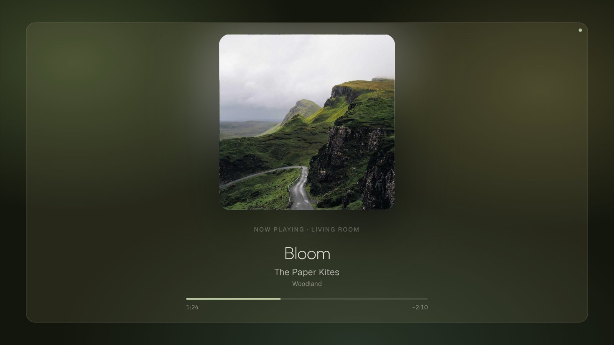</td>
  </tr>
  <tr>
    <td align="center"><b>Someone's at the door.</b> The front door appears in full screen right away – on every display, over a single camera connection.</td>
    <td align="center"><b>Now playing.</b> The cover on every song change – and if you like, the whole screen takes on the album's colours.</td>
  </tr>
  <tr>
    <td>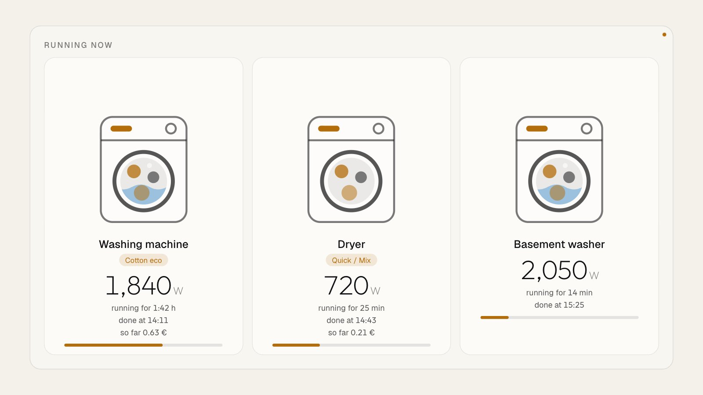</td>
    <td>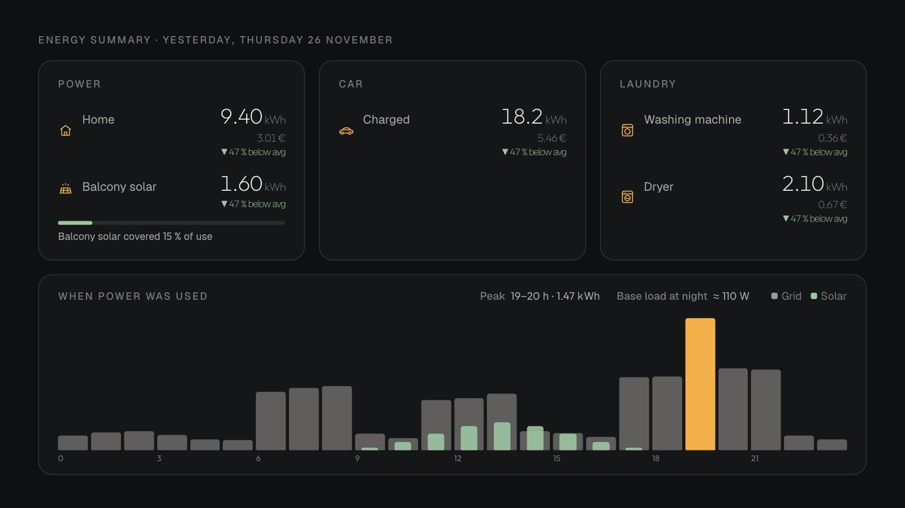</td>
  </tr>
  <tr>
    <td align="center"><b>Laundry at a glance.</b> Programme, power, “done at” and what the cycle has cost so far – animated while the machine runs.</td>
    <td align="center"><b>Where your power goes.</b> A daily summary with cost, solar share, comparison with the average and an hourly profile.</td>
  </tr>
  <tr>
    <td>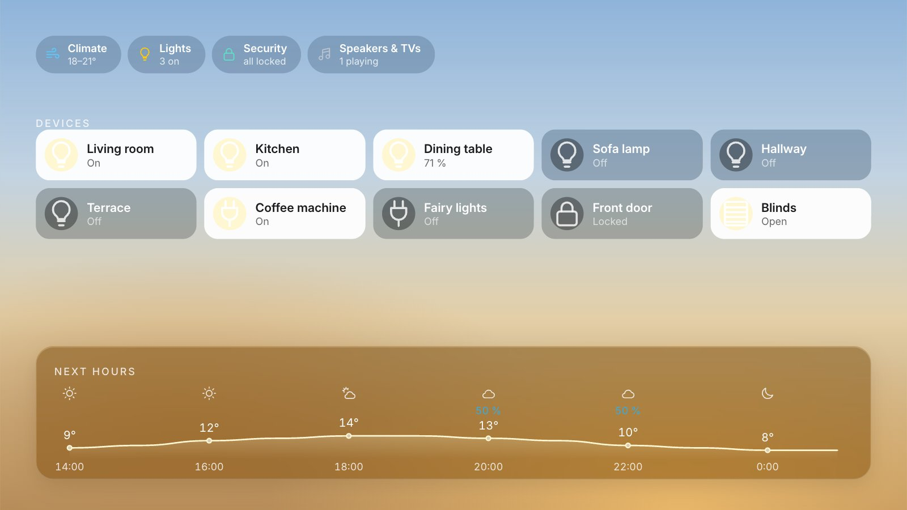</td>
    <td>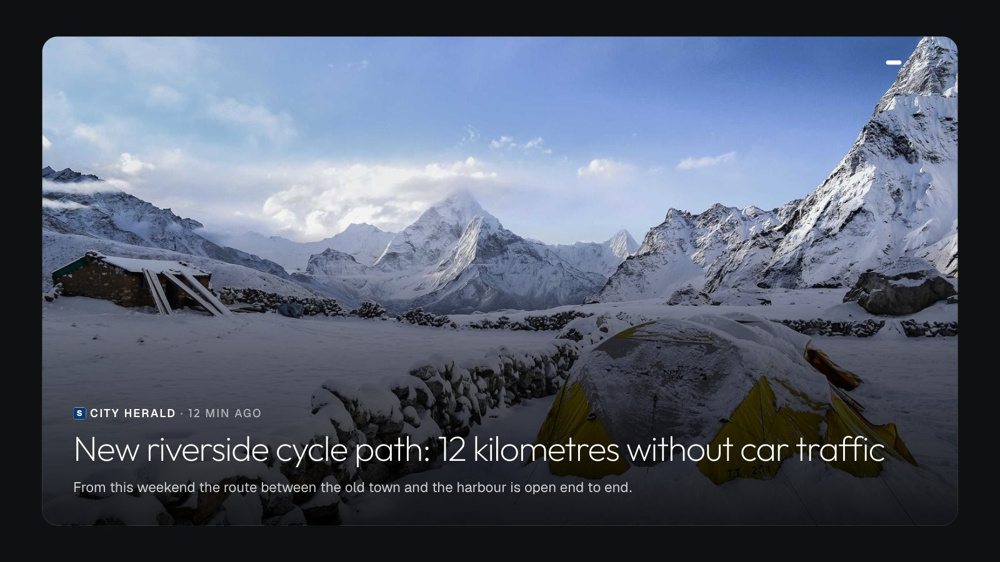</td>
  </tr>
  <tr>
    <td align="center"><b>Like a smart home app.</b> Tap to switch lights and plugs, with the state of the house at the top.</td>
    <td align="center"><b>News.</b> From any RSS feed, with a large photo and the source's logo – or as a ticker across every page.</td>
  </tr>
  <tr>
    <td>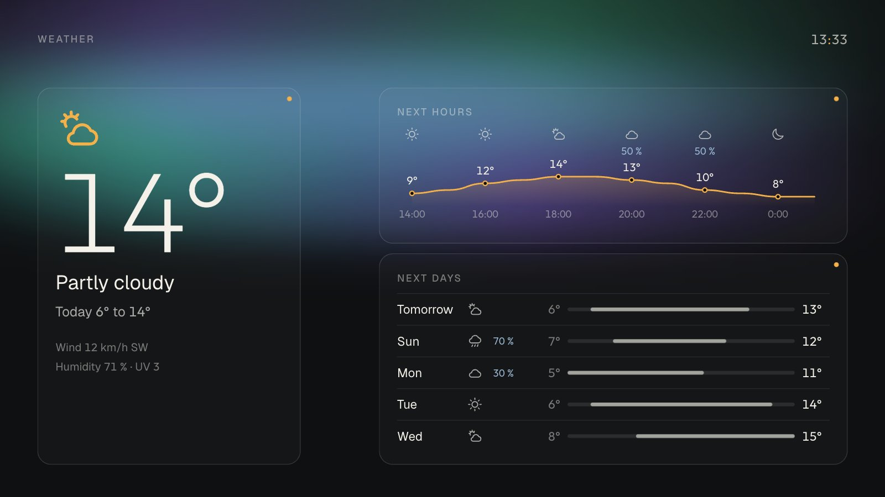</td>
    <td>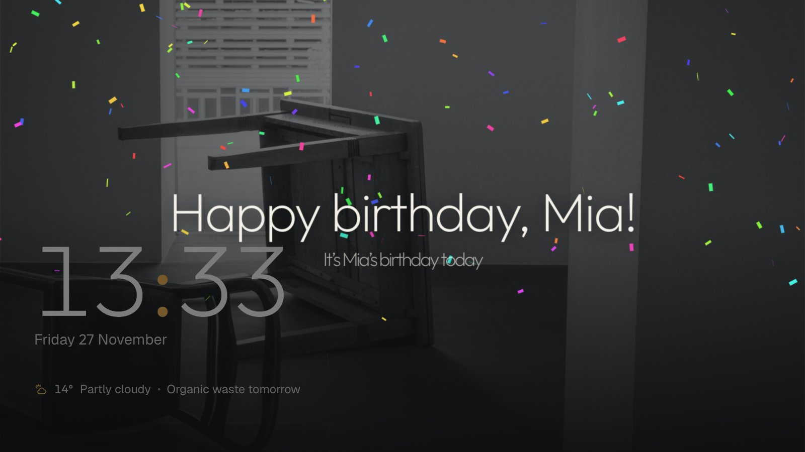</td>
  </tr>
  <tr>
    <td align="center"><b>28 ambient animations.</b> Aurora, snow, a fireplace, raindrops on the window – or simply “like the weather”.</td>
    <td align="center"><b>Special moments.</b> Confetti, fireworks or hearts – automatically from your birthday calendar, for example.</td>
  </tr>
  <tr>
    <td>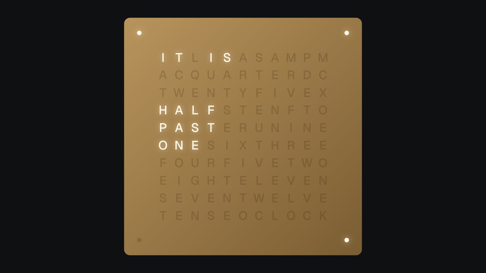</td>
    <td>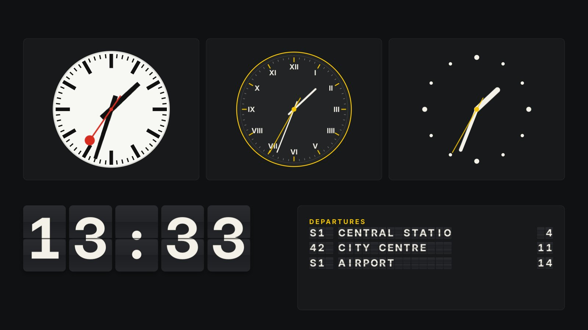</td>
  </tr>
  <tr>
    <td align="center"><b>Word clock</b> in four languages – black, white, brass or copper.</td>
    <td align="center"><b>Clocks to fall for.</b> Station, elegant, dots – and split-flap like on the platform.</td>
  </tr>
  <tr>
    <td>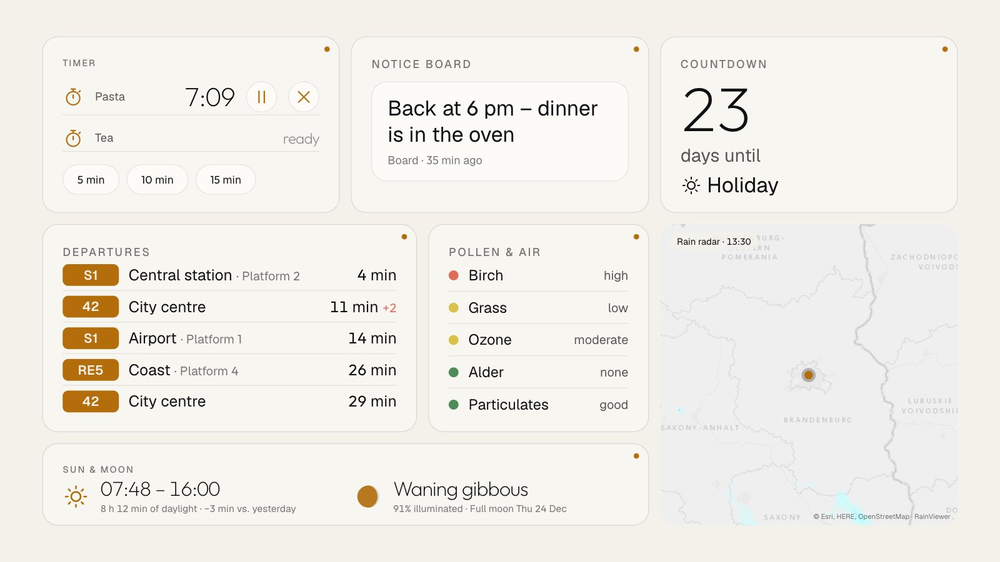</td>
    <td></td>
  </tr>
  <tr>
    <td align="center"><b>For everyday life.</b> Kitchen timer, notice board, countdown, departures, pollen and rain radar.</td>
    <td align="center"><b>And most of the time: simply beautiful.</b> Your photos from HA, iCloud or Google – time and weather on top.</td>
  </tr>
</table>

### 30 styles – one click

<p align="center">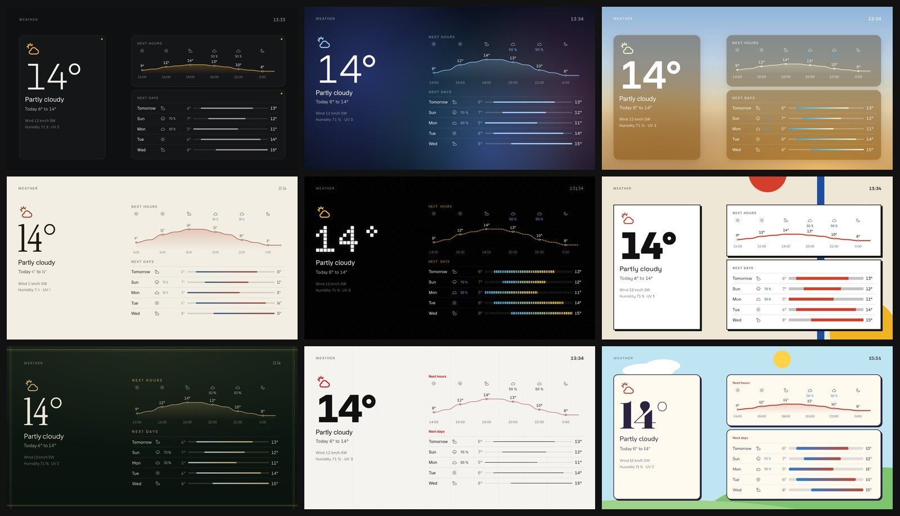</p>

<p align="center"><sub>The same page in Ambiframe, Glass, At Home, Editorial, Pixel, Bauhaus, Lobby, Swiss Grid and Picture book.<br>In the Studio the preview shows any style as soon as you hover over it.</sub></p>

<sub>Screenshots with sample data. Photos: <a href="https://www.instagram.com/chris.gunia">Chris Gunia</a> (the built-in sample photos); front door, news photos and covers: Unsplash. The news sources in the screenshots are made up.</sub>

## On the wall in five minutes

1. **Install** – with the button above via HACS (or [manually](#manually)), then restart Home Assistant.
2. **Add the integration** – *Settings → Devices & services → Add integration → Ambiframe*.
3. **Follow the wizard** – Open **Ambiframe** in the sidebar. The wizard asks about the room, contents, moments and
   photos, and builds a ready-to-go configuration from your devices: weather, rooms by area, waste calendar.
4. **Connect the tablet** – Copy the display's address from the Studio and open it on the tablet
   (ideally in [Fully Kiosk Browser](https://www.fully-kiosk.com)). Done.

On iPad and iPhone it works without Fully too: put the `custom:ambiframe-card` card on a dashboard and open the HA app
in kiosk mode.

## The Studio – everything with a live preview

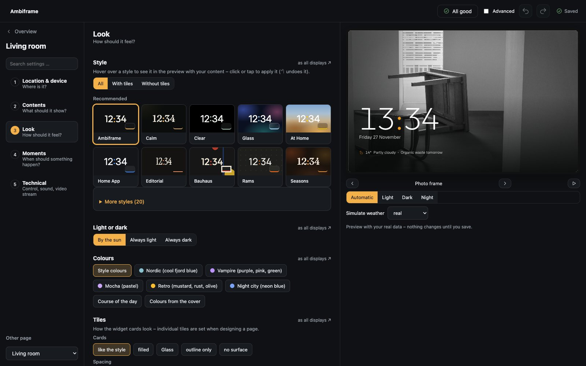

No YAML, no guessing. The Studio thinks from the display and asks five simple questions:

| Step | Question | What you set |
|---|---|---|
| **Location & device** | Where does it hang? | Room (sets sensible defaults), device (Fully, browser or HA app) with an address to copy |
| **Contents** | What should it show? | Pages in the playlist, order by dragging, duration, “When?” (e.g. mornings only) and the night |
| **Look** | How should it feel? | Style, light/dark, colours, tiles, ambient animation, motion |
| **Moments** | When should something happen? | Doorbell, motion, laundry done, music, birthday … with **▶ Test** and your own sounds |
| **Technical** | Control, sound, TV | Control mode, restart button, offline alert, sounds, video stream to the TV |

On the right the **preview always runs with your real data**: flip through pages, switch light/dark/night, simulate the
weather (sun, rain, snow, wind) and test moments – without saving anything. **↶ ↷** undoes any step, and at the top
Ambiframe tells you when something is missing – **Show** jumps straight to it. **All displays** holds what applies to
every display; each display can differ.

<table>
  <tr>
    <td width="50%">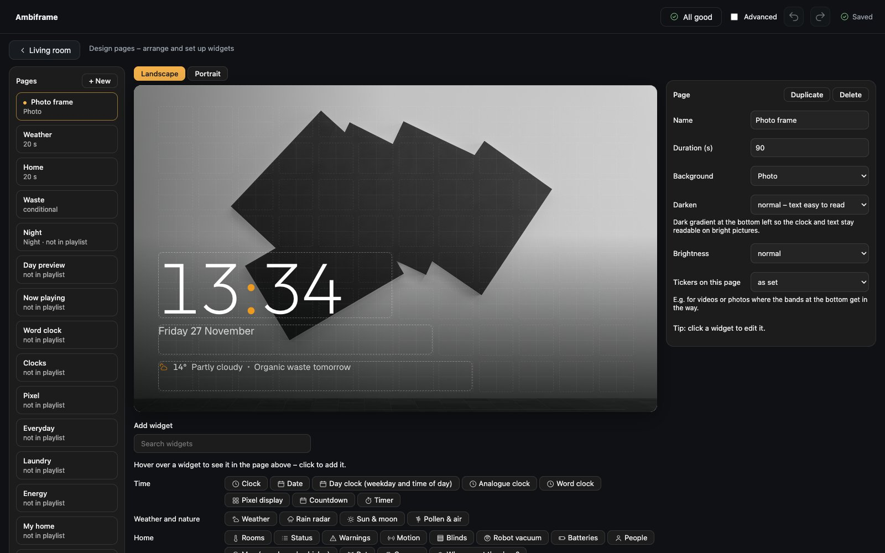</td>
    <td width="50%">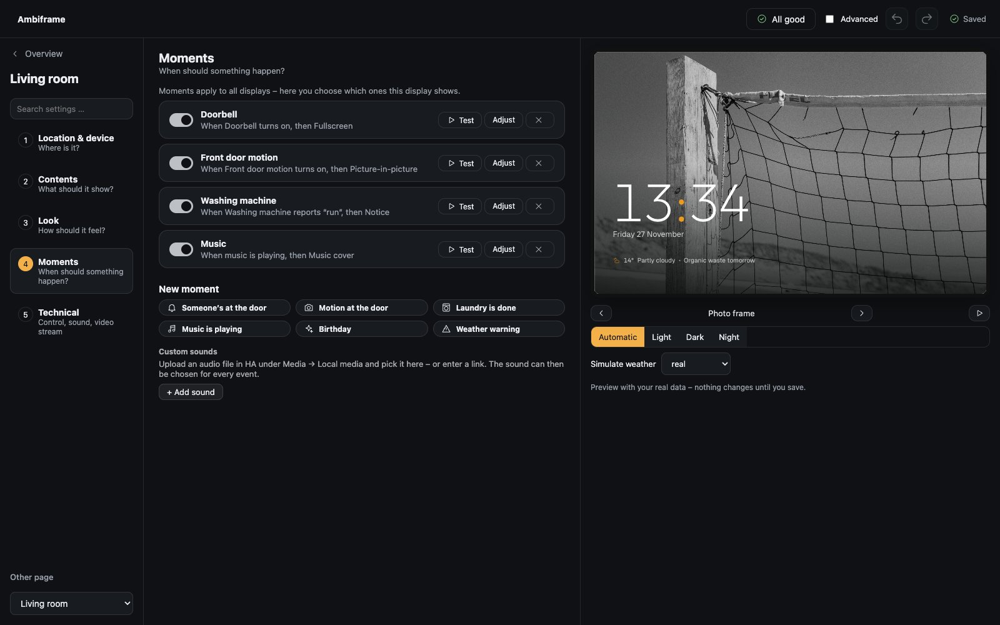</td>
  </tr>
  <tr>
    <td align="center"><b>Page editor.</b> Drag, resize and align widgets – with guides, multi-select, ⌘C/⌘V and your own templates.</td>
    <td align="center"><b>Moments.</b> Ready-made templates, triggers suggested from your entities, tested with one click.</td>
  </tr>
</table>

## Everything Ambiframe can do

<details open>
<summary><b>🔔 Moments – the screen speaks up when it matters</b></summary>

- **Doorbell and cameras:** full screen with live video (`alarm`) or picture-in-picture (`live`) – two cameras side by
  side, tap to enlarge, corner, size and shape adjustable. All displays share **one** connection to the camera
  (important for cameras that allow only a few, e.g. Tapo); until the live picture runs, the last snapshot shows.
- **Notices:** first a card, then a small reminder in the top right – like “Laundry done”. Several stack up like
  notifications on an iPhone; the **notification centre** shows what happened, grouped by day.
- **Music:** the cover on every song change as a card, full screen, bar, pill or mini card – even mini *and* briefly
  full screen. If you like, the whole screen takes on the album's colours.
- **Show a page:** a motion sensor triggers and the right page appears – as long as it stays on, with hold time,
  maximum and cooldown.
- **Occasions:** confetti, fireworks, hearts, glitter … with a big title – e.g. “Happy birthday!” from a birthday calendar.
- **With sound and rules:** chime, ding-dong, bell, alarm or your own sounds from HA media; quiet hours (muted or not at
  all), “only when someone is home”, any conditions, buttons and `event.*` entities.
- **Who was at the door?** The latest doorbell and camera moments with a snapshot.

</details>

<details>
<summary><b>🧩 55 widgets – from the clock to any Lovelace card</b></summary>

- **Time:** clock, date, word clock (4 languages, 4 faces), analogue clocks (station, plain, elegant, dots), split-flap,
  LED pixel display, **day clock for seniors** (“Tuesday – afternoon”, no digits at all).
- **Weather:** now, card, hours, days, rain preview, animated **rain radar**, sun & moon, pollen & air, DWD and NINA
  **warnings** with the source's logo.
- **Home:** rooms with ventilation tips, a “right now” status, **smart home tiles** with overview pills, blinds,
  batteries, robot vacuum with map, pet, print job/3D printing, Wi-Fi QR code for guests.
- **Energy:** electricity price (Tibber, cheapest hours), solar and consumption, biggest consumers, **daily and weekly
  summary** with hourly profile, cost and solar share, **appliances** with programme, time left and cost, car (battery,
  range, charging, lock).
- **On the go:** map with people and cars, commute time (“leave by 7:29”), departures, calendar and agenda, waste
  collection with **German bins in their real colours** – or the yellow bag.
- **Everyday:** kitchen timer, notice board (set from your phone), countdown, to-do and shopping list (tap to tick off).
- **Reading:** news from any RSS/Atom feed (with logos, and every source is checked as you add it), *tagesschau in
  100 seconds* as video, Wikipedia article and quote of the day, an **AI summary** in the morning (via `ai_task`).
- **Free building blocks:** text with Jinja and Markdown, history (line, area, bars), gauge (ring/half), image, camera
  and webcam – and **any Lovelace card**.
- **Tap actions:** every widget can toggle, run an action, show a page or a pop-up with a Lovelace card – with a
  confirmation if you like (“Open the gate – really?”).

The full list with every option is under [Widgets](#widgets).

</details>

<details>
<summary><b>🎨 Look – 30 styles, animations, motion</b></summary>

- **30 styles, each light and dark:** **Ambiframe** (the brand's own style and the default: ink and paper, fine rounded frames, a single point of amber light), Calm, **Clear** (like StandBy), Glass, Aurora, Editorial, Pixel, Arcade, Cockpit,
  At Home, Home App, Axel, Clear text, Split-flap, Bauhaus, Soft UI, Boho, Country house, **Gallery**, **Paper**,
  **E-Ink** (for e-paper displays), Art Deco, Terminal, Playful, **Wayfinding**, **Swiss Grid**, **Rams**, **Lobby**,
  **Picture book** (for children) – and **Seasons**, which changes by itself: spring to winter, Christmas, New Year's
  Eve, Valentine's Day, Easter, Halloween. Every style meets a checked minimum contrast.
- **Light and dark by the sun** – with a soft cross-fade – or fixed, per display.
- **Colour palettes** (Nordic, Vampire, Mocha, Retro, Night city) or **Course of the day**: colours drift with the time.
- **28 ambient animations:** particles, aurora, fog, snow, raindrops on the window, wind, clouds, starry sky, fireflies,
  leaves, cherry blossoms, fireplace, lava lamp, waves … or **like the weather**.
- **Motion with feeling:** bars grow, lines draw in, numbers count up – calm, springy or fading. Widgets that stay the
  same on the next page simply stay put during the transition.
- **10 page transitions:** fade, blur, slide, zoom, cube, flip, page turn, curtain, circle, rise – or a different one
  each time.
- **Tickers in style:** floating, as a bar or just a line – matching the chosen style.
- **13 fonts** bundled locally, card styles (filled, glass, outline), your own colours for light and dark, custom CSS,
  save, share and import styles.

</details>

<details>
<summary><b>📰 Tickers – only there when something applies</b></summary>

- **Home ticker:** appears only while something applies – a window open for 20 minutes, the washing machine done, a
  battery below 15 %, a severe weather warning. Groups combine lines (“3 windows open”), and tapping a line shows the
  details.
- **News ticker** across every page – mixed with the home ticker and the current song if you like.
- New items join at the back – nothing you're reading jumps.

</details>

<details>
<summary><b>📷 Photos – yours, from any source</b></summary>

- Any **HA media source** (folder, Immich, Synology Photos …), a shared **iCloud** or **Google Photos album**.
- Portrait photos on landscape displays shown as a **side-by-side pair** instead of cropped.
- Until you add your own: built-in sample photos (offline too), Wikimedia picture of the day, public-domain paintings,
  NASA images.
- Webcams and HA cameras as a page background.

</details>

<details>
<summary><b>📺 Devices and operation – it just keeps running</b></summary>

- **Any tablet:** Fully Kiosk (wakes the screen for moments and turns it off when everyone is away), any browser, iPad
  and iPhone via the HA app.
- **On the TV:** as a video stream to Apple TV (AirPlay) or LG webOS – see
  [`docs/airplay-apple-tv.md`](docs/airplay-apple-tv.md).
- **Landscape and portrait:** pages rearrange themselves in portrait; any aspect ratio without black bars.
- **Night mode** with a dimmed, wandering clock. **Control mode:** a tap brings up your HA dashboard, after a minute it returns.
- **Controllable from Home Assistant:** every display is a device with *Page*, *Pause*, *Next page*, *Reload* and
  *Connected* – ideal for automations (“car arrives home → energy page”).
- **Keeps itself running:** if a display hangs, Ambiframe restarts it; after an update every display reloads itself –
  never in the middle of a doorbell.
- **Readable from afar:** distance pages with one single, huge piece of information.
- **Four languages:** English, German, Dutch, French – interface, Studio and AI summary.
- Everything is **stored in Home Assistant** and is part of every backup.

</details>

## Installation

### HACS (recommended)

<a href="https://my.home-assistant.io/redirect/hacs_repository/?owner=diggi-85&repository=ambiframe&category=integration"></a>

Or by hand:

1. HACS → ⋮ → *Custom repositories* → `https://github.com/diggi-85/ambiframe`, type *Integration*.
2. Install “Ambiframe” and restart Home Assistant.
3. *Settings → Devices & services → Add integration → Ambiframe*.

### Manually

Copy `custom_components/ambiframe` to `/config/custom_components/`, restart, add the integration.

### Setting up the tablet

1. Open **Ambiframe** in the sidebar, choose the display (or **+ Add display**) and copy its address under
   **Location & device**, e.g. `http://homeassistant.local:8123/ambiframe-display?display=ambiframe`.
2. Enter it as the start URL on the tablet (recommended: [Fully Kiosk Browser](https://www.fully-kiosk.com)) and sign in
   once – ideally with a separate HA user without admin rights.
3. Optionally enable the *JavaScript interface* in Fully: Ambiframe then wakes the screen for moments.

## FAQ

<details>
<summary><b>Which tablet do I need?</b></summary>

Any with an up-to-date browser. Inexpensive Android tablets with Fully Kiosk are ideal, because Ambiframe can then wake
the screen and turn it off. iPads run through the HA app. On slower devices Ambiframe picks lighter transitions by
itself, and for e-paper displays there's the **E-Ink** style with no motion at all.

</details>

<details>
<summary><b>Does Ambiframe replace my dashboard?</b></summary>

It complements it. Ambiframe is for the screen you glance at in passing. Tap it and **control mode** brings up your
usual HA dashboard; after a minute without touch, Ambiframe returns. Any Lovelace card can also be placed directly as a
widget.

</details>

<details>
<summary><b>Do I need an account or a cloud?</b></summary>

No. Ambiframe runs entirely inside your Home Assistant and stores everything there. It only goes online for content you
choose yourself – news feeds, the rain radar, placeholder photos or a shared album, for example.

</details>

<details>
<summary><b>Do I need to know YAML?</b></summary>

No. Everything is done in the Studio with a live preview. If you want, *Advanced* shows the whole configuration as YAML –
see [For advanced users](#for-advanced-users).

</details>

<details>
<summary><b>What does it cost?</b></summary>

Nothing. Ambiframe is open source under the MIT license.

</details>

---

## For advanced users

### Configuration

In the Studio under **All displays → Photos & AI → For advanced users: YAML** (with **Advanced**) or with the action
`ambiframe.import_config`. Ambiframe creates a matching starter
configuration on first start; you can view and adjust it there as YAML. A complete example is in
[`examples/beispiel.yaml`](examples/beispiel.yaml).

```yaml
displays:
  - id: living_room
    name: Living room
    playlist: [{ page: photo }, { page: weather, duration: 20 }]
    watchdog: { notify: 30 }    # HA notification after 30 min offline
    night: { entity: input_boolean.night, page: night }
    control: { enabled: true, dashboard: /lovelace/0, idle: 60 }

pages:
  - id: photo
    name: Photo frame
    duration: 90
    background: { type: photo, shade: light }   # shade: none | light | strong
    widgets:
      - { id: clock, type: clock, x: 0, y: 4, w: 6, h: 2, options: { valign: end } }
      - { id: date, type: date, x: 0, y: 6, w: 7, h: 1 }

events:
  - id: doorbell
    entity: binary_sensor.front_door_ring
    to: "on"
    kind: alarm                 # alarm | live | info | page | media | effect
    camera: camera.front_door
    title: Someone is at the door
    where: Front door
    hold_after: 30              # keep it on screen for 30 s after the ring

  - id: dining_table
    kind: page                  # show a page instead of an overlay
    entity: binary_sensor.dining_table_presence
    entities: [binary_sensor.kitchen_motion]   # more triggers – any one is enough
    to: "on"
    page: today
    duration: 60
    hold_after: 30
    cooldown: 300

  - id: music
    kind: media
    entities: [media_player.kitchen, media_player.living_room]
    style: card                 # card | fullscreen
```

### Widgets

| Type | Main options |
|---|---|
| `clock` | `size` (auto/small), `seconds`, `font`, `color`, `style: flap` (split-flap) |
| `analog` | `face` (schlicht/bahnhof/elegant/punkte), `seconds`, `numbers` |
| `wordclock` | `face` (black/white/brass/copper/accent), `color`, `font`, `glow`, `dots`, `prefix`, `language` |
| `pixel` | `items: [{type: time/date, entity, attribute, text, icon, unit, decimals, color}]`, `interval`, `frame` |
| `date` | `format` (long/short), `size`, `color`, `style: card` |
| `dayclock` | Day clock for older people: weekday and time of day in words (“Tuesday – Afternoon”), date below; `date: false`, `time: true`, `color` |
| `text` | `text` (may contain Jinja), `markdown`, `style` (label/title/body/big, `huge` fills the box), `size`, `color`, `icon` |
| `chart` | `entities: [{entity, name, color}]`, `kind` (line/area/bar), `hours`, `period` (hour/day), `value`, `min`, `max`, `unit`, `decimals`, `label`, `style: card` |
| `gauge` | `entity`, `attribute`, `kind` (ring/half), `min`, `max`, `unit`, `decimals`, `color`, `severity: [{from, color}]`, `name`, `icon` |
| `image` | `url` (link, `/local/…`, `media-source://…`, template) or `entity`, `fit` (cover/contain), `refresh`, `caption`, `radius` |
| `weather` | `entity`, `variant` (now/card/hourly/daily/rain/line), `hours`, `days`, `name`, `rain_sensor`, `threshold` |
| `value` | `entity`, `attribute`, `name`, `unit`, `decimals`, `style` (`card`, or `huge` – fills the box), `label`, `icon`, `sub`, `secondary`, `cold` |
| `rooms` | `rooms: [{name, temperature, humidity, climate, windows}]`, `cold`, `warm`, `columns` |
| `status` | `windows` (auto/list), `appliances`, `lights: auto`, `waste`, `waste_days`, `extra`, `max` |
| `calendar` | `entity`, `variant` (card/line), `waste`, `days`, `label` |
| `infoline` | `items: [{type: weather/calendar/entity/text/…, …}]` |
| `camera` | `entity` or `url` (webcam), `mode` (live/snapshot), `refresh`, `title`, `text`, `radius` |
| `agenda` | `calendars`, `days`, `max`, `location` |
| `today` | `calendars`, `weather` – appointments, weather and waste for the day |
| `waste` | `bins: [{name, entity, color, out}]`, `max`, `highlight` (days) |
| `activity` | `variant: list` (default: one line), `entities`, `exclude`, `max`, `within` (minutes) |
| `warnings` | Open warnings with headline, level, time span, sender and description – NINA (old and new integration) and DWD, the same warning only once: `entities` (empty = found automatically), `variant: full` (one card per warning with description, recommendation, measured values, time span, sender, affected areas and warning colour), `calm_text` |
| `list` | `rows: [{name, entity, attribute, icon, format, unit, decimals}]` |
| `persons` | `persons: [{entity, name, location}]` |
| `media` | `entities`, `variant: full` (default: compact), `show_paused` |
| `appliances` | `items: [{name, running, icon, power, progress, end, cost, program}]`, `variant: cards` (one animated card per running appliance), `empty_text` |
| `price` | `entity`, `home` (Tibber), `window` (cheapest hours), `tomorrow`, `note` |
| `power` | `production: [{name, entity}]`, `consumption`, `consumption_first`, `forecast`, `forecast_remaining`, `extra`, `extra_name` |
| `consumers` | `count`, `devices`, `exclude` |
| `balance` | `switch_hour`, `period: week` (weekly review), `profile: {entity, solar}` (hourly profile), `compare` (comparison with the average), `groups` (YAML) |
| `batteries` | `part`, `devices`, `threshold`, `max`, `exclude` |
| `car` | `name`, `battery`, `range`, `location`, `charging`, `plugged`, `charger_power`, `time_full`, `lock`, `limit`, `inside_temp` |
| `vacuum` | `vacuums: [{entity, name, battery, room, map}]` |
| `covers` | `covers: [{entity, name, invert}]`, `only_open` |
| `pet` | `name`, `visits`, `unit`, `days`, `icon` |
| `job` | `title`, `progress`, `remaining`, `end`, `layer`, `layers`, `status`, `temps` (e.g. 3D printer) |
| `qr` | `ssid`, `password`, `encryption`, `hidden`, `show_password`, `hint` or `image` |
| `news` | `variant` (`list`/`ticker`, default: large image), `feeds`, `interval`, `max`, `speed` |
| `newsvideo` | The latest *tagesschau in 100 Sekunden*, muted and looping, with the current headlines beside or below it (on e-ink only the preview image). For private, non-commercial use only, as tagesschau allows (at most 60 requests per hour – the video check makes 4, checking every 15 minutes): `headlines` (false = video only), `layout` (`below`, or `fullscreen` – video only, edge to edge), `until_end` (next page only after the video, at most 5 minutes), `feeds`, `max`, `label` |
| `daily` | `kind: quote` (default: Wikipedia article), `language`, `source`, `image` |
| `summary` | `style: card` (default: no frame), `size` |
| `timer` | `entities` (timer.*, empty = all), `presets` ("5, 10, 15" minutes), `target`, `show_idle` |
| `board` | `entities` (input_text/text, empty = names with "board", "message", "note"), `expire_hours`, `size`, `empty_text` |
| `countdown` | `items: [{name, date \| entity, icon}]` (input_datetime, timestamp sensor, calendar), `max`, `show_past` |
| `departures` | `entities` (public transport sensors, empty = automatic), `lines`, `walk` (minutes), `max`, `show_platform`, `attribute` |
| `doorlog` | Who was at the door: the last doorbell and camera moments with a snapshot (HA keeps 20, stored in `/config/ambiframe/snapshots`): `max` |
| `map` | People and vehicles on a map that fits itself (people at the same place as one avatar stack): `entities` (person.*, device_tracker.*; empty = everyone with a location), `exclude` (never shown), `away_only`, `tags` (full/name/none), `routes` (travel time sensors – their route is drawn; the start and destination addresses are sent once to OpenStreetMap's Nominatim and OSRM, an unknown start falls back to `zone.home`), `zone`, `max_zoom`, `map` (auto/light/dark/osm) |
| `todo` | To-do or shopping list (todo.*), live; tap to check off with 4 s to undo: `entity`, `check: false`, `max`, `show_completed`, `size` |
| `commute` | Travel time from Waze/Google/HERE sensors: `routes: [{entity, name, arrive ("08:00" → leave by), usual (minutes)}]` |
| `radar` | `zoom` (4–7), `map` (auto/light/dark/osm), `map_url`, `frames` (6 = last hour), `speed`, `latitude`/`longitude` |
| `sky` | `show` (sun/moon, empty = both), `latitude`/`longitude` (default: home) |
| `air` | `entities: [{entity, name, kind, scale}]` (pollen, aqi, pm25, pm10, ozone, no2; empty = automatic), `only_elevated`, `max` |
| `hometiles` | Smart home tiles: `entities` (tapping toggles lights, switches, fans), `label` |
| `pills` | Overview pills: climate, lights, security, speakers – found automatically from your entities |
| `card` | `card:` any Lovelace card configuration |

All widgets support `align`/`valign` (start/center/end), `show_if` (conditions) as well as `tap_action` and
`hold_action`:

```yaml
tap_action: { action: toggle, entity: light.kitchen }
tap_action: { action: perform, perform: script.turn_on, entity: script.good_night, confirm: true }
tap_action: { action: page, page: energy }
tap_action: { action: popup, title: Light, card: { type: entities, entities: [light.kitchen] }, timeout: 30 }
hold_action: { action: pause }          # also: more_info (entity), dashboard
look: { card: true, accent: "#4fa3e0", ink: "#fff", size: 120, opacity: 80, padding: 12 }
```

### Conditions

```yaml
show_if:
  - { condition: state, entity: binary_sensor.window, state: "on" }
  - { condition: numeric, entity: sensor.co2, above: 1000 }
  - { condition: within_days, entity: calendar.waste, days: 1 }
  - { condition: time, after: "05:00", before: "11:00" }
  - { condition: changed, entity: binary_sensor.door, minutes: 10 }      # changed recently (optional state)
  - { condition: template, value_template: "{{ is_state('person.alex', 'home') }}" }
  - { condition: display, displays: [living_room] }                    # only on these displays
  - { condition: orientation, orientation: portrait }                    # portrait only
  - condition: or                                                        # also and / not, nested at will
    conditions:
      - { condition: state, entity: person.kim, state: home }
      - { condition: state, entity: person.alex, state: home }
```

Conditions apply to pages, widgets and **individual playlist entries** (`playlist[].show_if`) – so a display can show
different pages in the morning than in the evening (editor: *Playback → When?*).

## Development

```bash
cd frontend && npm install && npm run build      # bundle into custom_components/ambiframe/frontend/
```

Tests: `cd frontend && npm test` (frontend) and `python -m pytest` (integration, dependencies in
`requirements_test.txt`). `cd frontend && npm run visual` compares every style as an image against reference images
(needs Chrome; on the first run create them with `npm run visual:update`). Which requirement is covered by which test
is listed in [`docs/testmatrix.md`](docs/testmatrix.md) (German).

## License

MIT. The bundled fonts are licensed under the SIL Open Font License 1.1. The built-in sample photos are by
[Chris Gunia](https://www.instagram.com/chris.gunia) – all rights reserved, for use within Ambiframe only.
